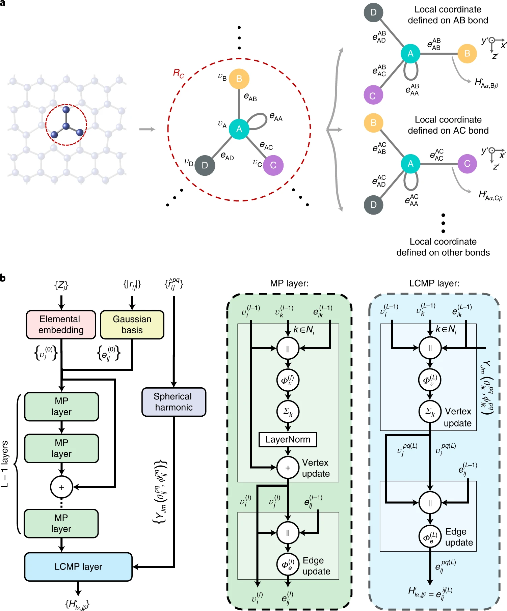

# DeepH

[Deep-learning density functional theory Hamiltonian for efficient ab initio electronic-structure calculation](https://www.nature.com/articles/s43588-022-00265-6)

## Introduction

DeepH learns density functional theory (DFT) Hamiltonian matrix elements from
crystal structures. By combining locality of electronic interactions with graph
neural network message passing, the model predicts Hamiltonian blocks on
periodic atom-pair edges and enables efficient downstream electronic-structure
calculation without repeatedly running expensive self-consistent DFT.



Figure source: [Nature Computational Science, Fig. 2](https://www.nature.com/articles/s43588-022-00265-6/figures/2).

## Model

DeepH represents a crystal as a periodic graph. Nodes are atoms, edges are atom
pairs within a cutoff radius, and each edge corresponds to a Hamiltonian block
$H_{ij}$ between local atomic orbitals. The PaddleMaterials integration reuses
the suite graph converter to build the periodic crystal graph and keeps the
DeepH-specific LCMP subgraph features for angular message passing.

For an edge $(i, j)$, the target is the selected orbital entry or block of
$H_{ij}$. Edge distances are expanded by Gaussian radial bases, angular
features are generated from spherical harmonics in local frames, and stacked
message-passing layers update atom/edge representations. A final edge decoder
predicts Hamiltonian entries with a masked mean-squared-error objective:

$$
\mathcal{L} =
\frac{\sum_{(i,j),k} M_{ij,k}(\hat{H}_{ij,k}-H_{ij,k})^2}
{\sum_{(i,j),k} M_{ij,k}}.
$$

## Results

| Model | Dataset | Test loss (MSE) | Config | Checkpoint |
| --- | --- | --- | --- | --- |
| DeepH | Graphene | 0.01068 | [deeph_graphene](deeph_graphene.yaml) | [Weights and data](https://pan.baidu.com/s/1g81PFfsgsN7zrYEp6e55uw?pwd=n2ue) (code: n2ue) |

The 450 Graphene structures are split into 270 training, 90 validation and
90 test samples using the fixed [split manifest](graphene_split.json), generated
with seed 42.

## Data preparation

Download `deeph_graphene_dataset.zip` (450 Graphene structures),
`deeph_graphene.zip` (configuration, split manifest and checkpoint), and
`SHA256SUMS` from the link above. Place these files in the repository root,
then verify and extract them:

```bash
sha256sum -c SHA256SUMS
mkdir -p data/deeph
unzip deeph_graphene_dataset.zip -d data/deeph
unzip deeph_graphene.zip -d data/deeph
cp data/deeph/deeph_graphene/checkpoints/best.pdparams data/deeph/graphene/best.pdparams
```

The prepared structures are under `data/deeph/graphene/processed/`.
Only the Graphene dataset is needed for this configuration.

## Training

Run from the repository root after [installing PaddleMaterials](../../../README.md).
This example was tested with PaddlePaddle GPU 3.2.2. The OpenMX inference
workflow additionally requires `h5py`.

```bash
python electronic_structure/train.py \
  -c electronic_structure/configs/deeph/deeph_graphene.yaml
```

## Evaluation

```bash
python electronic_structure/train.py \
  -c electronic_structure/configs/deeph/deeph_graphene.yaml \
  Global.do_train=False Global.do_eval=False Global.do_test=True \
  Trainer.pretrained_model_path=data/deeph/graphene/best.pdparams
```

## CINN evaluation

Use FP32 matrix multiplication for matching eager and compiled predictions:

```bash
NVIDIA_TF32_OVERRIDE=0 python electronic_structure/train.py \
  -c electronic_structure/configs/deeph/deeph_graphene.yaml \
  Global.do_train=False Global.do_eval=False Global.do_test=True \
  Trainer.pretrained_model_path=data/deeph/graphene/best.pdparams \
  Execution.backend=cinn
```

On an RTX 3090 with PaddlePaddle 3.2.2, a single Graphene sample took
10.47 ms in eager mode and 7.70 ms with CINN (5 warmup steps, 20 timed steps,
GPU synchronization after each step). The maximum output difference was
`1.15e-5`. These timings exclude graph preparation and external DFT calculation.

For OpenMX calculation and Hamiltonian export, see
[DeepH inference](../../../ppmatSim/configs/deeph/README.md).

## Citation

```bibtex
@article{li2022deeph,
  title={Deep-learning density functional theory Hamiltonian for efficient ab initio electronic-structure calculation},
  author={Li, He and Wang, Zun and Zou, Nianlong and Ye, Meng and Xu, Runzhang and Gong, Xiaoxun and Duan, Wenhui and Xu, Yong},
  journal={Nature Computational Science},
  volume={2},
  number={6},
  pages={367--377},
  year={2022},
  publisher={Nature Publishing Group}
}
```
