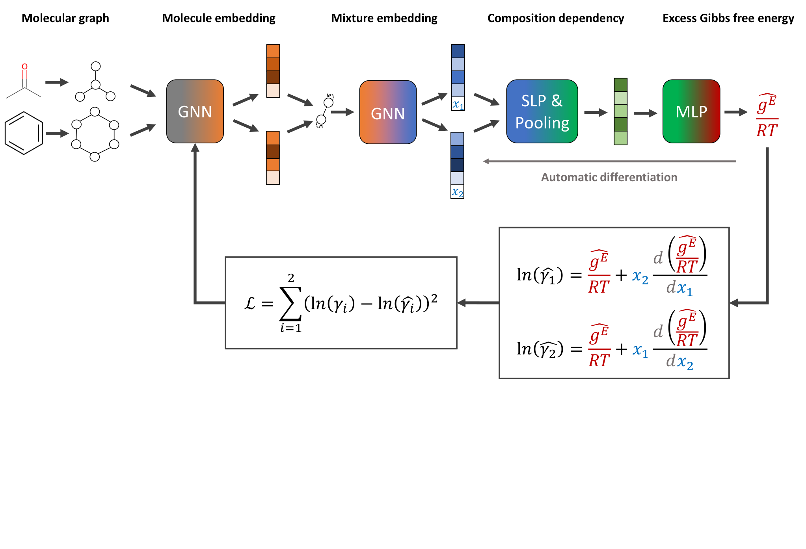

# GE-GNN

[Thermodynamics-consistent graph neural networks](https://doi.org/10.1039/D4SC04554H)

## Abstract

GE-GNN predicts the dimensionless excess Gibbs free energy of binary solvent mixtures. Its composition derivative gives the logarithmic activity coefficients while satisfying the Gibbs-Duhem relation:

```math
\ln \gamma_1 = G^E + (1-x_1)\frac{dG^E}{dx_1}, \qquad
\ln \gamma_2 = G^E - x_1\frac{dG^E}{dx_1}.
```

## Model



Figure 1 from Jan G. Rittig and Alexander Mitsos, [arXiv:2407.18372v1](https://arxiv.org/html/2407.18372v1#S2.F1), reproduced without modification under [CC BY 4.0](https://creativecommons.org/licenses/by/4.0/).

The two solvents share a molecular GCN encoder. An interaction MPNN captures hydrogen-bond information, and a composition-dependent readout predicts the excess Gibbs free energy.

## Results

| Model | Dataset | Property | MAE (Val) | Config | Checkpoint |
| --- | --- | --- | --- | --- | --- |
| gegnn_binary_activity (1 edge feature) | binaryGamma | ln(gamma1), ln(gamma2) | — | [config](gegnn_binary_activity.yaml) | — |
| gegnn_binary_activity (3 edge features) | binaryGamma | ln(gamma1), ln(gamma2) | — | [config](gegnn_binary_activity.yaml), `Model.__init_params__.edge_in_feats=3` | [checkpoint](https://paddle-org.bj.bcebos.com/paddlematerials/checkpoints/property_prediction/ge-gnn/gegnn_binary_activity.zip) |

## Training

Prepare the dataset using the [binaryGamma dataset instructions](../../../ppmat/datasets/README_binary_activity.md).

```bash
python property_prediction/train.py -c property_prediction/configs/gegnn/gegnn_binary_activity.yaml
```

## Validation

```bash
python property_prediction/train.py -c property_prediction/configs/gegnn/gegnn_binary_activity.yaml Global.do_train=False Global.do_eval=True Global.do_test=False Trainer.pretrained_model_path=output/YOUR_TRAINING_RUN/checkpoints
```

## Prediction

The mixture CSV contains `smiles1`, `smiles2` and `x1`. Predictions are saved as `ln_gamma1` and `ln_gamma2`.

```bash
python property_prediction/predict.py --config_path=property_prediction/configs/gegnn/gegnn_binary_activity.yaml --checkpoint_path=output/YOUR_TRAINING_RUN/checkpoints/best.pdparams --input_format=mixture_csv --input_path=property_prediction/example_data/binary_mixtures.csv
```

For the downloadable three-edge-feature checkpoint:

```bash
python property_prediction/predict.py --config_path=property_prediction/configs/gegnn/gegnn_binary_activity.yaml --checkpoint_path=https://paddle-org.bj.bcebos.com/paddlematerials/checkpoints/property_prediction/ge-gnn/gegnn_binary_activity.zip --input_format=mixture_csv --input_path=property_prediction/example_data/binary_mixtures.csv Model.__init_params__.edge_in_feats=3
```

## Citation

```bibtex
@article{rittig2024thermodynamics,
  title={Thermodynamics-consistent graph neural networks},
  author={Rittig, Jan G. and Mitsos, Alexander},
  journal={Chemical Science},
  volume={15},
  pages={18504--18512},
  year={2024},
  doi={10.1039/D4SC04554H}
}
```
