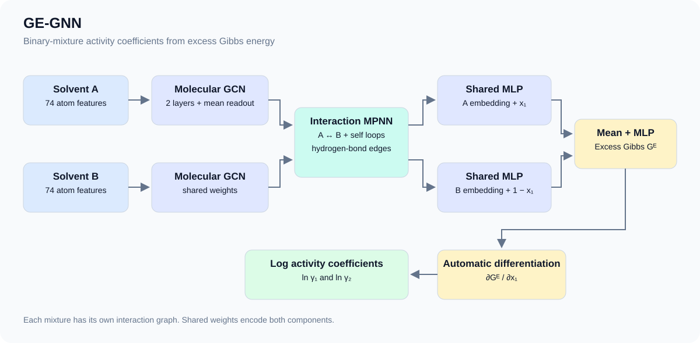

# GE-GNN

[Thermodynamics-consistent graph neural networks](https://doi.org/10.1039/D4SC04554H)

## Abstract

GE-GNN predicts the dimensionless excess Gibbs free energy of binary solvent mixtures. Differentiation with respect to the mole fraction gives logarithmic activity coefficients that satisfy the Gibbs-Duhem relation:

```math
\ln \gamma_1 = G^E + (1 - x_1) \frac{dG^E}{dx_1}, \qquad
\ln \gamma_2 = G^E - x_1 \frac{dG^E}{dx_1}.
```

## Model



The two solvents share a molecular GCN encoder and exchange hydrogen-bond information through an interaction MPNN. A shared composition-dependent MLP and mean pooling produce the excess Gibbs energy; automatic differentiation produces the two log activity coefficients.

## Results

| Model | Edge features | Epochs | Fold | Validation MAE | Config | Checkpoint |
| --- | --- | --- | --- | --- | --- | --- |
| Recovered reference GE-GNN | 1 | Not verified | comp_inter / 0-4 | 0.024247 +/- 0.000542 | [config](gegnn_binary_activity.yaml) | Awaiting BCE hosting |
| Legacy checkpoint | 3 | 100 | Full-data training | Not evaluated | Same config with `Model.__init_params__.edge_in_feats=3` | [checkpoint](https://paddle-org.bj.bcebos.com/paddlematerials/checkpoints/property_prediction/ge-gnn/gegnn_binary_activity.zip) |

Five historical best checkpoints were recovered from Git LFS and reevaluated on reconstructed `comp_inter`, seed-2021 validation folds with official PaddlePaddle 3.2.2 on an RTX 3090. No new training was performed. The values below are means and population standard deviations across the five folds; each fold contains 56,000 validation records.

| Metric | Fold mean | Fold standard deviation |
| --- | ---: | ---: |
| MAE | 0.024247 | 0.000542 |
| RMSE | 0.071269 | 0.011791 |
| R2 (uniform average over components) | 0.992473 | 0.002611 |

Checkpoint hashes and all 23 parameter names/shapes were verified. The original per-fold epoch logs and training indices were not recovered, so these reevaluations do not independently certify 100 training epochs per fold or the original train/validation membership. The earlier two-epoch pipeline check is retained in [validation.json](validation.json). The public legacy checkpoint predates corrected batching and is not held-out evidence.

The paper reports comp-inter MAE 0.020 and RMSE 0.068; this reevaluation is not a claim of a matched-protocol 1% reproduction result. The tested whole-model CINN conversion crashed with SIGSEGV, so no compiler acceleration is reported. Domestic-device verification remains outstanding.

## Data preparation

Follow the repository [installation instructions](../../../Install.md). The model and tests have been checked with Python 3.10 and official PaddlePaddle 3.2.2; GPU training was checked with PaddlePaddle 3.0.0 and an RTX 3090. The recovered fold evaluation was also run with official PaddlePaddle 3.2.2 GPU.

The binaryGamma data originate from Qin et al. and are distributed with the [reference implementation](https://git.rwth-aachen.de/avt-svt/public/GDI-NN). The activity CSV contains `solv1`, `solv2`, `solv1_x`, `solv1_gamma`, `solv2_gamma` and `tpsa_binary_avg`; the gamma columns are **logarithmic** activity coefficients. `solvent_list.csv` maps `solvent_id` to `smiles_can`.

Prepare fold 0 once before training. Missing source data and solvent metadata are downloaded with the shared download utilities and MD5 verification.

```bash
python -m ppmat.datasets.split_binary_activity_data --mode=comp_inter --fold=0 --seed=2021 --output_dir=data/binary_activity/fold_0
```

This follows the reference TPSA-stratified five-fold protocol: 224,000 training rows and 56,000 validation rows. `split.json` records the source SHA-256, seed and exact row indices. The preprocessing tool also supports `--mode=system_extra` to hold out complete solvent pairs. For another fold, choose a new output directory and update both dataset paths in the configuration.

## Training

The reference model uses 74 atom features, one scalar hydrogen-bond feature per interaction edge, hidden dimension 256, Softplus readout, Adam at 0.001, batch size 256 and 100 epochs. `eval_metric` selects the best checkpoint. Splitting and feature encoding remain outside the dataset's record-reading logic.

```bash
python property_prediction/train.py -c property_prediction/configs/gegnn/gegnn_binary_activity.yaml
```

The trainer appends a timestamp and seed to its output directory. In the following commands, replace `YOUR_TRAINING_RUN` with that directory name.

## Validation

```bash
python property_prediction/train.py \
    -c property_prediction/configs/gegnn/gegnn_binary_activity.yaml \
    Global.do_train=False \
    Global.do_eval=True \
    Global.do_test=False \
    Trainer.pretrained_model_path=output/YOUR_TRAINING_RUN/checkpoints
```

Keep `Trainer.eval_with_no_grad=False` and `Predict.eval_with_no_grad=False`: activity coefficients require the composition derivative.

For all five recovered checkpoints, first prepare fold directories 0-4 with the preprocessing command above, then reevaluate without training:

```bash
python tests/evaluate_gegnn_folds.py --checkpoint_dir=path/to/recovered_checkpoints --data_root=data/binary_activity --output_path=gegnn_fold_evaluation.json --device=gpu:0
```

The checkpoint directory must contain `gegnn_binary_gamma_fold0_best.pdparams` through `gegnn_binary_gamma_fold4_best.pdparams`. The tool verifies source hashes, validation rows, checkpoint structures and complete five-fold coverage before reporting MAE/RMSE/R2.

## Prediction

The example CSV contains `smiles1`, `smiles2` and `x1` (the first solvent's mole fraction). The shared `PropertyPredictor` builds and caches solvents, batches the mixtures and saves `ln_gamma1` and `ln_gamma2` to `results/result.csv`. Set `--batch_size` to control prediction batching.

For weights trained with the reference configuration:

```bash
python property_prediction/predict.py --config_path=property_prediction/configs/gegnn/gegnn_binary_activity.yaml --checkpoint_path=output/YOUR_TRAINING_RUN/checkpoints/best.pdparams --input_format=mixture_csv --input_path=property_prediction/example_data/binary_mixtures.csv
```

For the existing public **legacy** ZIP, explicitly select three edge features. The repository YAML supplies the vocabulary and graph settings missing from the old package. A mismatched checkpoint dimension raises an error instead of silently leaving parameters uninitialized.

```bash
python property_prediction/predict.py --config_path=property_prediction/configs/gegnn/gegnn_binary_activity.yaml --checkpoint_path=https://paddle-org.bj.bcebos.com/paddlematerials/checkpoints/property_prediction/ge-gnn/gegnn_binary_activity.zip --input_format=mixture_csv --input_path=property_prediction/example_data/binary_mixtures.csv Model.__init_params__.edge_in_feats=3
```

## Tests

```bash
python -m pytest -q test/test_gegnn.py test/test_binary_activity_split.py test/test_gegnn_evaluation.py
```

For optional cross-framework verification, install PyTorch 2.2.2 and DGL 1.1.3 in a separate environment, download `model/model_GNN.py` from the reference repository, and run:

```bash
python tests/compare_gegnn_reference.py --reference_model_path=reference_model_GNN.py --output_path=gegnn_alignment.json
```

The tool compares identical weights, predictions, losses and gradients over two Adam steps for hidden dimensions 8 and 256. Only the reference model's device calls are changed from CUDA to CPU. The measured maximum prediction difference is `3.58e-7`; this local check does not establish the full training accuracy or compiler speedup targets.

## Citation

```bibtex
@article{rittig2024thermodynamics,
  title={Thermodynamics-consistent graph neural networks},
  author={Rittig, Jan G. and Mitsos, Alexander},
  journal={Chemical Science},
  volume={15},
  pages={18504--18512},
  year={2024},
  doi={10.1039/D4SC04554H}
}
```
