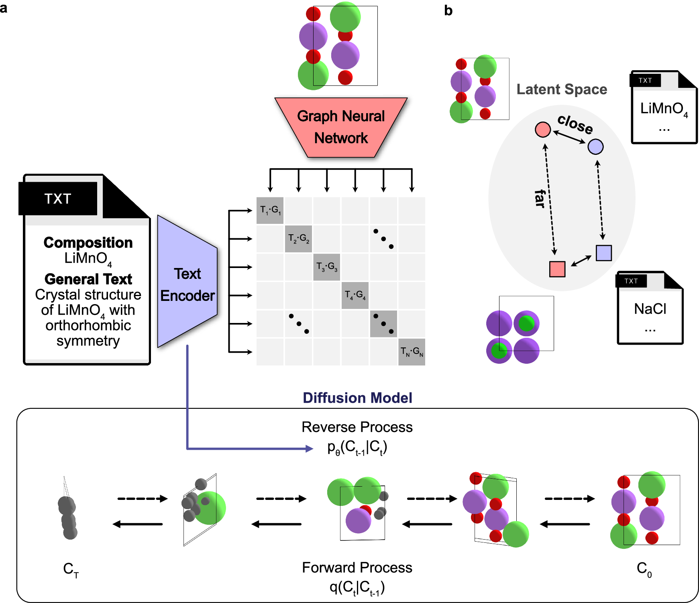

# Chemeleon

[Exploration of crystal chemical space using text-guided generative artificial intelligence](https://doi.org/10.1038/s41467-025-59636-y)

## Abstract

Chemeleon is a text-conditioned diffusion model for crystal structure generation: given a text prompt such as a composition, it denoises atom types, the lattice matrix, and fractional coordinates into a periodic crystal. Three diffusion processes run in lockstep — an absorbing-state discrete diffusion (D3PM) over atom types, a variance-preserving diffusion over the lattice, and a variance-exploding diffusion over fractional coordinates on a torus — and share a single CSPNet decoder pass per step. Text conditions enter the decoder through a FiLM layer, and sampling combines a predictor-corrector scheme with classifier-free guidance. The architecture follows the official work; this directory contains the PaddlePaddle implementation, verified against the official implementation by deterministic replay in fp64.



---

## Model Description

A crystal is represented as atom types $A = (a_1,\ldots,a_N)$ (vocabulary of 104 entries: 103 elements plus one absorbing dummy state), fractional coordinates $F \in [0,1)^{3 \times N}$, and a lattice matrix $L \in \mathbb{R}^{3 \times 3}$ (upper-triangular effective freedom of 6 entries). Each process corrupts its own channel:

- **Atom types (D3PM):** an absorbing-state transition matrix $Q_t$ progressively replaces tokens with the dummy state; the model learns $q(x_{t-1} \mid x_t, x_0)$ with a hybrid VB + CE objective.
- **Lattice (VP diffusion):** standard DDPM noising $L_t = \sqrt{\bar\alpha_t}\,L_0 + \sqrt{1-\bar\alpha_t}\,\epsilon$, with cosine $\beta$ over 1000 timesteps.
- **Coordinates (VE diffusion):** wrapped-normal noising $F_t = w(F_0 + \sigma_t \epsilon)$ with a score-matching target, sampled by an ancestral predictor plus a Langevin corrector.

The denoiser is a CSPNet over the fully-connected atom graph: periodic Fourier features of fractional-coordinate differences feed message passing layers, a FiLM layer injects the time and text embeddings into every layer, and three readout heads predict the atom-type logits, the lattice noise, and the coordinate score. The text front-end (WordPiece tokenizer + BERT-base encoder + projection MLP) is bundled with the model under `ppmat/models/chemeleon/`, so no extra NLP packages are required; the transformer backbone is frozen during diffusion training. This config conditions on the composition string (e.g. `Li2O`, from the `composition` csv column, `text_targets: ["composition"]`); the original release also describes a two-stage recipe with a contrastively trained text encoder for richer text prompts.

## Dataset Description

`mp-40` contains Materials Project structures with fewer than 40 atoms per unit cell, split into 28,636 / 3,181 / 708 structures for train / val / test. Each record carries a `cif` string plus text-target columns (the original descriptions were generated with an LLM, the OpenAI API in the original preparation). The csv files are downloaded automatically by `MP40Dataset` on first use, so no manual data preparation is required. The original release provides the processed csv files and a preparation notebook:

- csv files: [data/mp-40](https://github.com/hspark1212/chemeleon/tree/main/data/mp-40)
- preparation: [data_preparation.ipynb](https://github.com/hspark1212/chemeleon/blob/main/data/mp-40/data_preparation.ipynb)

## Commands

### Training

```bash
# multi-gpu training (example with 4 GPUs)
python -m paddle.distributed.launch --gpus="0,1,2,3" structure_generation/train.py -c structure_generation/configs/chemeleon/chemeleon_mp40.yaml
# single-gpu training
python structure_generation/train.py -c structure_generation/configs/chemeleon/chemeleon_mp40.yaml
```

### Sample

```bash
# Generate structures from a text condition (composition prompt).
# --num_atoms must match the stoichiometry of the composition (Li2O -> 3).
# Results are saved to the folder specified by --output_path (default: results).
python structure_generation/sample.py --config_path='structure_generation/configs/chemeleon/chemeleon_mp40.yaml' --checkpoint_path='./output/chemeleon_mp40/checkpoints/latest.pdparams' --mode=by_condition --condition text=Li2O --num_atoms=3 --output_path='result_chemeleon_mp40/'
```

## Citation

```bibtex
@article{park2025exploration,
  title={Exploration of crystal chemical space using text-guided generative artificial intelligence},
  author={Park, Hyunsoo and Onwuli, Anthony and Walsh, Aron},
  journal={Nature Communications},
  volume={16},
  number={1},
  pages={1--14},
  year={2025},
  publisher={Nature Publishing Group}
}
```
