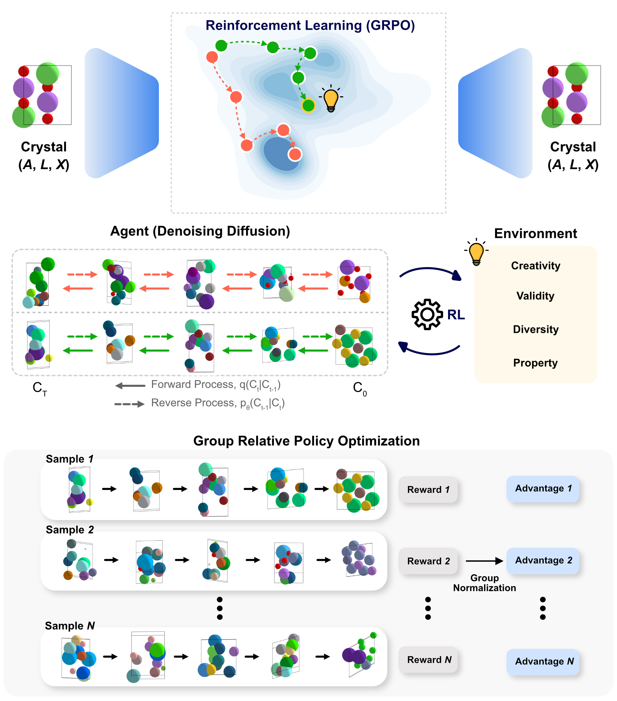

# Chemeleon2

[Guiding Generative Models to Uncover Diverse and Novel Crystals via Reinforcement Learning](https://arxiv.org/abs/2511.07158)

## Abstract

Chemeleon2 combines a variational autoencoder (VAE), latent diffusion and
reinforcement learning to generate periodic crystal structures. The VAE learns
continuous representations of crystal geometry and composition, a diffusion
Transformer learns to generate these representations, and Group Relative Policy
Optimization (GRPO) adapts the generator using rewards for novelty, diversity or
material properties. PaddleMaterials provides all three stages through the
unified `Chemeleon2` model.



---

## Model Description

### Overview

A periodic crystal unit cell is represented as:

- atom types (composition): $A = (a_1,\ldots,a_N)$
- fractional coordinates: $X \in [0,1)^{N \times 3}$
- lattice matrix: $L \in \mathbb{R}^{3 \times 3}$

The VAE maps these inputs to eight latent values per atom. Generation denoises
a latent sample and decodes it into $(A,L,X)$; the requested atom count is fixed
while atom types and geometry are generated.

The unified `Chemeleon2` model selects VAE training, latent diffusion or GRPO
fine-tuning through `stage: vae`, `diffusion` or `rl`. VAE training alone does not
provide de novo sampling. The released vocabulary supports atomic numbers 1
through 99; index zero is reserved for corruption.

### Method

#### 1) Crystal representation learning

The VAE encoder produces a Gaussian posterior for each atom's latent vector.
The decoder reconstructs atomic numbers, fractional coordinates, lattice lengths
normalized by $N^{1/3}$, and lattice angles. Training combines atom classification,
coordinate and lattice reconstruction losses, and KL regularization. Translation,
rotation and coordinate/type corruption can be enabled during training.

#### 2) Latent diffusion and sampling

The diffusion stage freezes the VAE. For a posterior sample $z$ and the stored
latent scale $s$, the normalized representation is $z_0=z/s$. Gaussian corruption
is applied in this continuous latent space:

$$
z_t = \sqrt{\bar{\alpha}_t}\,z_0
    + \sqrt{1-\bar{\alpha}_t}\,\epsilon,
\qquad \epsilon \sim \mathcal{N}(0,I).
$$

The diffusion Transformer predicts $\epsilon$ with a mean squared error loss over
unpadded atomic latents. Sampling reverses this process, rescales the generated
latents by $s$ and decodes the crystal. DDIM with 50 inference steps is the
default; fixed-variance DDPM is also supported. Atom types and fractional
coordinates are reconstructed by the VAE rather than diffused separately.

Conditional models use `condition_names` and `property_embeddings_adapt_cfg`.
The supported encoders are `ValueEncoder`, `CategoricalEncoder`,
`CompositionEncoder` and `ChemicalSystemEncoder`. `p_unconditional` controls
joint condition dropout, and `cfg_scale` controls classifier-free guidance.
The supplied LDM checkpoint is unconditional. Fixed-composition sampling via
`by_chemical_formula` is unsupported.

#### 3) Reward-guided fine-tuning

As illustrated above, the diffusion model acts as the policy and decoded
crystals are scored by the reward function. GRPO normalizes rewards within
rollout groups and optimizes a clipped policy objective with KL and entropy
regularization. RL uses stochastic DDIM trajectories (`eta > 0`); only the
denoiser is updated.

The supplied RL configuration combines `CreativityReward`,
`StructureDiversityReward` and `CompositionDiversityReward`. Novelty and diversity
use the MP20 training structures serialized as a list of pymatgen structures in
`data/mp_20/novelty_reference.pkl`. Energy rewards additionally require an ASE
calculator injected through `build_model` and a pickled phase diagram.

---

## Dataset Description

Chemeleon2 reuses the existing `MP20Dataset` and its standard train/validation/test splits.

---

## Results

| Model | Dataset | S.U.N. (%) | Stable (%) | Unique (%) | Novel (%) | RMSD (Å) | GPUs | Training Time | Config | Checkpoint / Log |
| --- | --- | --- | --- | --- | --- | --- | --- | --- | --- | --- |
| chemeleon2_mp20_ldm | mp20 | 6.00 | 6.20 | 93.00 | 99.80 | 0.120 | 1 | ~0.7 hours | [chemeleon2_mp20_ldm.yaml](chemeleon2_mp20_ldm.yaml) | [checkpoint / log](https://paddle-org.bj.bcebos.com/paddlematerials/checkpoints/structure_generation/Chemeleon2/chemeleon2_ldm.zip) |

Metrics are for the released `chemeleon2_ldm` checkpoint on 1,000 MP20-sized
structures (DDIM 50 steps, seed 2024). Stability requires converged MatterSim 5M
relaxation with energy above the convex hull ≤ 0 eV/atom (845,997 uncorrected
GGA/GGA+U references). RMSD is the mean minimum-image displacement between
generated and relaxed structures.

---

## Command

### Training
```bash
# single-gpu training
python structure_generation/train.py -c structure_generation/configs/chemeleon2/chemeleon2_mp20_ldm.yaml
```

### Validation
```bash
# Adjust program behavior on the fly using command-line parameters without modifying the configuration file directly.
# Example: Global.do_eval=True
python structure_generation/train.py -c structure_generation/configs/chemeleon2/chemeleon2_mp20_ldm.yaml Global.do_eval=True Global.do_train=False Global.do_test=False Trainer.pretrained_model_path='path/to/model.pdparams'
```

### Testing
```bash
# Evaluate the model on the test dataset.
python structure_generation/train.py -c structure_generation/configs/chemeleon2/chemeleon2_mp20_ldm.yaml Global.do_eval=False Global.do_train=False Global.do_test=True Trainer.pretrained_model_path='path/to/model.pdparams'
```

### Sample
```bash
# Predict crystal structures using a trained model.
# Mode 1: Use a pre-trained model (downloads automatically).
# Mode 2: Use a custom configuration file and checkpoint.
# Results are saved to the folder specified by --output_path (default: results).

# Mode 1: pre-trained model
python structure_generation/sample.py --model_name='chemeleon2_ldm' --mode='by_num_atoms' --num_atoms=20

# Mode 2: custom config + checkpoint
python structure_generation/sample.py --config_path='structure_generation/configs/chemeleon2/chemeleon2_mp20_sample.yaml' --checkpoint_path='path/to/best.pdparams' --mode='by_num_atoms' --num_atoms=20
```

---

## Citation
```
@article{Park2025chemeleon2,
  title={Guiding Generative Models to Uncover Diverse and Novel Crystals via Reinforcement Learning},
  author={Hyunsoo Park and Aron Walsh},
  year={2025},
  url={https://arxiv.org/abs/2511.07158}
}
```
