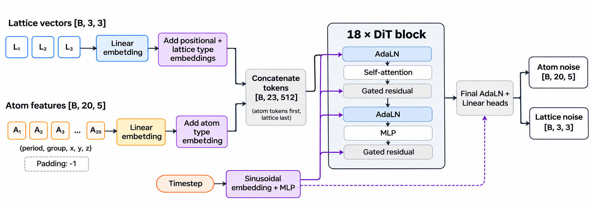

# CrystalDiT

[CrystalDiT: A Diffusion Transformer for Crystal Generation](https://arxiv.org/abs/2508.16614)

## Abstract

CrystalDiT is a diffusion transformer for crystal structure generation that
was proposed to improve crystal generation by simplifying
the model architecture. Instead of intricate, multi-stream designs,
CrystalDiT employs a unified transformer that treats lattice and atomic
properties as a single, interdependent system. The authors report a stable, unique and novel (S.U.N.) rate of 8.78%
on MP-20; this published DFT result is distinct from the Paddle evaluation below.



---

## Model Description

### Overview

A crystal is represented as a fixed-length token sequence:

- 3 lattice tokens: the rows of the lattice matrix $L \in \mathbb{R}^{3 \times 3}$,
  normalized by `max_length` (46.7425 Angstrom, the maximum lattice vector
  length in the MP-20 training subset);
- `max_atoms = 20` atom tokens, each a 5-dimensional feature vector
  $(r, c, x, y, z)$ where $(r, c)$ is the element position on the periodic
  table (period $r \in [0,7]$, group $c \in [0,18]$, both normalized to
  $[-1,1]$; lanthanides/actinides use fractional group offsets inside their
  f-block slot) and $(x, y, z)$ are fractional coordinates. Invalid padding
  atoms are $(-1,-1,-1,-1,-1)$.

Training preserves the original MP-20 cell and atom order. Niggli reduction
and canonicalization are disabled to match the pretrained lattice representation.

### Method

#### 1) Joint DDPM diffusion

Both the lattice matrix and the atom features are diffused with a standard
DDPM Gaussian process (OpenAI linear schedule, $T = 1000$):

$$
q(X_t \mid X_0) = \mathcal{N}\!\left(X_t \mid \sqrt{\bar\alpha_t}\,X_0,\ (1-\bar\alpha_t) I\right),
$$

Reverse step (fixed-small posterior variance, prediction clipped to $[-1,1]$):

$$
p_\theta(X_{t-1}\mid X_t) = \mathcal{N}\!\left(X_{t-1} \mid \mu_\theta,\ \sigma_t^2 I\right),
$$

Sampling starts from pure noise and runs the full 1000-step ancestral loop.

#### 2) Unified DiT denoiser with adaLN-Zero

The denoiser embeds 23 tokens (3 lattice + 20 atoms) and runs `depth = 18`
DiT blocks (d = 512, 8 heads) whose adaLN modulation is conditioned on the
sinusoidal timestep embedding:

$$
\hat\epsilon_L,\ \hat\epsilon_A = \mathrm{DiT}\!\left(L_t,\ A_t,\ t\right),
$$

Self-attention runs over the concatenated lattice + atom tokens so that the
lattice and the atoms influence each other at every layer.

#### 3) Training objective

$$
\mathcal{L} = \mathrm{mean}\!\left((\epsilon_L - \hat\epsilon_L)^2\right)
+ 100 \cdot \mathrm{mean}\!\left(W \odot \left(\epsilon_A - \hat\epsilon_A\right)^2\right),
$$

with per-feature weights $W = (1.5, 2.0, 1.0, 1.0, 1.0)$ emphasizing the
periodic-table position channels of the atom features.

#### 4) Structure reconstruction

Predicted atoms are mapped back to elements by DDPM discretization of the
continuous $(r, c)$ predictions over all candidate periodic-table positions
(Gaussian CDF, sigma = 0.1), filtering rare gases; predicted lattice rows are
multiplied by `max_length` to restore Angstrom units. Invalid atoms are
dropped from the output atom list.

---

## Dataset Description

MP-20 (Materials Project subset, max 20 atoms per cell) in CSV form:

#### MP-20 split (download link)

| Dataset | Train | Val | Test |
| --- | --- | --- | --- |
| [MP-20](https://paddle-org.bj.bcebos.com/paddlematerial/datasets/mp_20/mp_20.zip) | 27136 | 9047 | 9046 |

---

## Results

Converted pretrained weights evaluated on 1,000 unconditional samples with the
full 1,000-step DDPM schedule. All rates use the 1,000 requested samples as the
denominator. Unique counts one representative per StructureMatcher cluster;
Novel compares each constructed structure against all 27,136 training crystals;
UN counts unique representatives absent from that training reference.

| Model | Dataset | Struct. Valid (%) | Chem. Valid (%) | Overall Valid (%) | Unique (%) | Novel (%) | UN (%) | Density W1 (g/cm³) | Elements W1 | Config | Checkpoint / Log |
| --- | --- | --- | --- | --- | --- | --- | --- | --- | --- | --- | --- |
| crystaldit_mp20 | MP-20 | 97.50 | 87.30 | 85.20 | 99.20 | 69.20 | 68.90 | 0.2465 | 0.2094 | [crystaldit_mp20.yaml](crystaldit_mp20.yaml) | [checkpoint](https://paddle-org.bj.bcebos.com/paddlematerials/checkpoints/structure_generation/CrystalDiT/crystaldit_mp20.zip) |

Wasserstein distances compare jointly valid generated structures with all
9,046 MP-20 test crystals; lower is better. The matcher uses `ltol=0.2`,
`stol=0.3` and `angle_tol=5`. Structural and chemical validity reuse the
project's minimum-distance/volume and SMACT checks. These metrics measure
unconditional generation, so index-paired CSP match rate/RMS distance is not
applicable. Stability and S.U.N. require separate energy/convex-hull evaluation
and are not inferred from validity.

| Model | Dataset | Validation Loss | Test Loss | Config |
| --- | --- | --- | --- | --- |
| crystaldit_mp20 | MP-20 | 8.071255 | 8.115754 | [crystaldit_mp20.yaml](crystaldit_mp20.yaml) |

Losses use the complete validation/test splits with seed 42 and the weighted
joint denoising objective above. These are evaluations of converted pretrained
weights, not results of complete training with the current YAML. The generation
row is one stochastic run; repeated sampling can produce different values.

---

## Command

### Training

The config initializes from the registered pretrained package. To train from
scratch:

```bash
python structure_generation/train.py -c structure_generation/configs/crystaldit/crystaldit_mp20.yaml Trainer.pretrained_model_path=null
```

### Validation

```bash
python structure_generation/train.py -c structure_generation/configs/crystaldit/crystaldit_mp20.yaml Global.do_train=False Global.do_eval=True
```

### Testing

```bash
python structure_generation/train.py -c structure_generation/configs/crystaldit/crystaldit_mp20.yaml Global.do_train=False Global.do_test=True
```

### Sample

```bash
python structure_generation/sample.py --model_name=crystaldit_mp20 --mode=compute_metric
```

This downloads the registered weights and missing MP-20 reference data,
generates 1,000 structures with the full DDPM schedule, writes CIF files to
`results/`, and prints the generation metrics above. CrystalDiT generates
composition and atom count jointly; chemical-formula and property conditioning
are not supported. Use `--mode=by_dataloader` for generation without evaluation.

---

## Citation
```
@inproceedings{yi2026crystaldit,
  title={CrystalDiT: A Diffusion Transformer for Crystal Generation},
  author={Yi, Xiaohan and Xu, Guikun and Zhang, Zhong and Liu, Liu and Bian, Yatao and Xiao, Xi and Zhao, Peilin},
  booktitle={Proceedings of the AAAI Conference on Artificial Intelligence},
  volume={40},
  year={2026}
}
```
