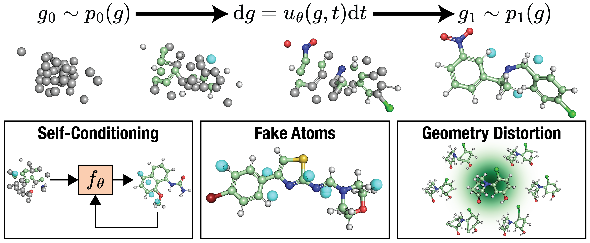

# FlowMol

[FlowMol3: Flow Matching for 3D De Novo Small-Molecule Generation](https://arxiv.org/abs/2508.12629)

## Abstract

FlowMol jointly generates molecular topology and three-dimensional coordinates
with mixed continuous and categorical flow matching. A Geometric Vector
Perceptron network predicts atomic positions, elements, formal charges and bond
orders from an interpolated molecular graph. FlowMol3 adds self-conditioning,
fake atoms and training-time geometry distortion to improve generation of
drug-like molecules with explicit hydrogens. This implementation provides QM9
training through the existing dataset pipeline and sampling with the converted
upstream FlowMol3 GEOM-Drugs checkpoint.



---

## Model Description

### Overview

FlowMol represents a molecule by coordinates $X$, atom types $A$, formal
charges $C$ and bond orders $E$, including explicit hydrogens. A GVP network on
the complete atom graph predicts the data endpoint from an interpolated state.

### Method

Coordinates interpolate between a centered Gaussian prior and the data:

$$
x_t = (1 - \alpha_t)x_0 + \alpha_t x_1.
$$

During training, the position prior can be aligned to the endpoint by Hungarian
assignment followed by SVD alignment. Categorical features use a masked CTMC
path:

$$
p(a_t \mid a_1) = (1 - \alpha_t)\delta_{\mathrm{mask}}
+ \alpha_t\delta_{a_1}.
$$

The endpoint objective combines coordinate MSE and categorical cross entropy:

$$
\mathcal{L} = \sum_{f \in \{x,a,c,e\}} w_f\mathcal{L}_f.
$$

Categorical losses supervise masked entries only. Optional time weighting uses
$\mathrm{clip}(\alpha_t/(1-\alpha_t), 0.05, 1.5)$.

Sampling uses Euler coordinate updates and CTMC category transitions over
250 time points by default. FlowMol3 also enables self-conditioning and removes
generated fake atoms before decoding. CINN compiles the GVP `denoise_step` core;
eager execution is the default.

---

## Dataset Description

The QM9 training configuration reuses `QM9Dataset` and its existing CSV splits:

| Dataset | Train | Val | Test |
| --- | --- | --- | --- |
| [QM9](https://paddle-org.bj.bcebos.com/paddlematerials/datasets/qm9/qm9.zip) | 110000 | 10000 | 10831 |

RDKit infers formal charges and kekulized bonds from QM9 coordinates;
`FlowMolStructure` supplies the training fields and position priors. Inferred
topology and dataset splits differ from upstream FlowMol, so QM9 results are not
directly comparable to its original benchmark.

The registered `flowmol3` checkpoint was trained upstream on GEOM-Drugs. Its
sampling configuration uses the released atom-count histogram and needs no
GEOM download. It provides neither GEOM training data nor QM9 pretrained weights.
`flowmol3.yaml` is sampling-only; `flowmol_qm9.yaml` also supports training and
evaluation. Each YAML defines its element vocabulary in `Global.atom_map`, whose
order must match the checkpoint.

---

## Results

Converted upstream GEOM-Drugs checkpoint, evaluated on 1,024 samples with
250 time points, batch size 16 and seed 42. This evaluates pretrained inference,
not QM9 training.

| Model | Dataset | Samples | Valid (%) | Unique (%) | Connected (%) | Stable Atoms (%) | Stable Molecules (%) | Config | Checkpoint |
| --- | --- | --- | --- | --- | --- | --- | --- | --- | --- |
| flowmol3 | GEOM-Drugs | 1024 | 100.00 | 99.90 | 98.93 | 100.00 | 100.00 | [flowmol3.yaml](./flowmol3.yaml) | [flowmol3.zip](https://paddle-org.bj.bcebos.com/paddlematerials/checkpoints/structure_generation/flowmol/flowmol3.zip) |

Validity checks complete molecules with RDKit. Uniqueness uses canonical
isomeric SMILES among valid molecules. Connectivity and valence stability use
all generated samples; stability is not an energy-based measurement.

| Model | Molecules | QED | Molecular Weight (g/mol) | cLogP | Heavy Atoms | MMFF94 RMSD (Angstrom) | Energy Decrease (kcal/mol/atom) |
| --- | --- | --- | --- | --- | --- | --- | --- |
| flowmol3 | 1013 | 0.7276 +/- 0.1381 | 312.35 +/- 67.63 | 2.6575 +/- 1.0932 | 21.95 +/- 4.83 | 0.6552 | 0.4307 |

The second table uses all 1,013 valid, connected molecules. Descriptors are
mean +/- population standard deviation. MMFF94 relaxation converged for all
molecules within 1,000 iterations; RMSD is the mean heavy-atom displacement
after rigid alignment, and energy decrease is averaged per atom including
hydrogens. These force-field diagnostics are not GFN2-xTB results.
Novelty requires the unavailable GEOM training reference set.

---

## Command

Run from the repository root. The QM9 configuration trains from scratch.

### Training

```bash
python structure_generation/train.py -c structure_generation/configs/flowmol/flowmol_qm9.yaml
```

### Validation

Validation and testing require replacing `path/to/model.pdparams` with a
checkpoint trained using `flowmol_qm9.yaml`; both report endpoint prediction losses.

```bash
python structure_generation/train.py -c structure_generation/configs/flowmol/flowmol_qm9.yaml Global.do_eval=True Global.do_train=False Global.do_test=False Trainer.pretrained_model_path='path/to/model.pdparams'
```

### Testing

```bash
python structure_generation/train.py -c structure_generation/configs/flowmol/flowmol_qm9.yaml Global.do_eval=False Global.do_train=False Global.do_test=True Trainer.pretrained_model_path='path/to/model.pdparams'
```

### Sample

```bash
python structure_generation/sample.py --model_name=flowmol3 --sampler=MolecularSampler --mode=by_dataloader
```

The registered GEOM checkpoint has a different architecture and cannot replace
that QM9 checkpoint. For custom QM9 sampling, replace `--model_name` with
`--config_path` and `--checkpoint_path`, and append `Dataset.train=null`.
Local YAML configurations select `MolecularSampler`; registered models select
the sampler through `--sampler`. Samples are saved as
`results/flowmol_samples.sdf` by default. `--input_path` overrides the sampling
dataset path when the selected dataset accepts a path.

Legacy configurations must use `InterpolantScheduler`. Legacy weights with
`separate_mol_updaters=True` and `convs_per_update=1` must omit the unused
`vector_field.node_position_updaters.0.*` and `vector_field.edge_updaters.0.*`
parameters. Use the updated package containing `checkpoints/best.pdparams`.

---

## Citation

```
@article{dunn2025flowmol3,
  title={FlowMol3: Flow Matching for 3D De Novo Small-Molecule Generation},
  author={Dunn, Ian and Koes, David Ryan},
  journal={arXiv preprint arXiv:2508.12629},
  year={2025}
}
```
