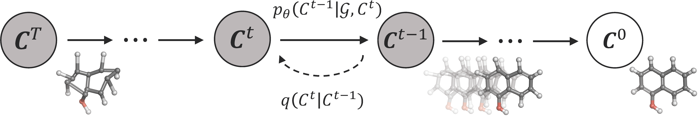

# GeoDiff

[GeoDiff: A Geometric Diffusion Model for Molecular Conformation Generation](https://arxiv.org/abs/2203.02923)

## Abstract

Predicting molecular conformations from molecular graphs is a fundamental problem in cheminformatics and drug discovery. Recent significant progress has been achieved with machine learning approaches, especially with deep generative models. Inspired by the diffusion process in classical non-equilibrium thermodynamics where heated particles will diffuse from original states to a noise distribution, in this paper, we propose a novel generative model named GeoDiff for molecular conformation prediction. GeoDiff treats each atom as a particle and learns to directly reverse the diffusion process (_i.e._, transforming from a noise distribution to stable conformations) as a Markov chain. Modeling such a generation process is however very challenging as the likelihood of conformations should be roto-translational invariant. We theoretically show that Markov chains evolving with _equivariant_ Markov kernels can induce an _invariant_ distribution by design, and further propose building blocks for the Markov kernels to preserve the desirable equivariance property. The whole framework can be efficiently trained in an end-to-end fashion by optimizing a weighted variational lower bound to the (conditional) likelihood. Experiments on multiple benchmarks show that GeoDiff is superior or comparable to existing state-of-the-art approaches, especially on large molecules.



---

## Model Description

### Overview

A molecule with $N$ atoms is an undirected graph $\mathcal{G} = \langle \mathcal{V}, \mathcal{E} \rangle$ whose vertices carry the element types and whose edges are labeled with the bond type. Its conformation is the coordinate matrix $C = [c_1; c_2; \cdots; c_N] \in \mathbb{R}^{N \times 3}$. GeoDiff is a conditional diffusion model $p(C^{0:T} \mid \mathcal{G})$: atom types and covalent bonds are supplied as input, and only the coordinates are generated. Each denoising step is shared by two branches, a global SchNet encoder over all atom pairs within a 10 Å cutoff and a local GIN encoder over the bonds and their two- and three-hop extensions. Both branches predict scores over interatomic distances, which are projected onto Cartesian coordinates so that the update is rotation-equivariant and translation-invariant.

### Method

#### 1) Forward diffusion (corruption)

$$
q(C^{1:T} \mid C^0) = \prod_{t=1}^{T} q(C^t \mid C^{t-1}), \qquad
q(C^t \mid C^{t-1}) = \mathcal{N}\!\left(C^t;\ \sqrt{1-\beta_t}\,C^{t-1},\ \beta_t I\right),
$$

so that $q(C^t \mid C^0) = \mathcal{N}\!\left(C^t;\ \sqrt{\bar{\alpha}_t}\,C^0,\ (1-\bar{\alpha}_t) I\right)$ with $\bar{\alpha}_t = \prod_{s=1}^{t} (1-\beta_s)$. The variances follow a sigmoid schedule between $\beta_1 = 10^{-7}$ and $\beta_T = 2 \times 10^{-3}$ with $T = 5000$.

#### 2) Equivariant reverse process (denoiser)

$$
p_\theta(C^{t-1} \mid \mathcal{G}, C^t) = \mathcal{N}\!\left(C^{t-1};\ \mu_\theta(\mathcal{G}, C^t, t),\ \sigma_t^2 I\right), \qquad
\mu_\theta(\mathcal{G}, C^t, t) = \frac{1}{\sqrt{\alpha_t}}\left(C^t - \frac{1-\alpha_t}{\sqrt{1-\bar{\alpha}_t}}\,\epsilon_\theta(\mathcal{G}, C^t, t)\right).
$$

$\epsilon_\theta$ is a composition of graph field network (GFN) layers. With node embeddings $h^l$, coordinates $x^l$ and edge features $e_{ij}$, layer $l$ computes

$$
m_{ij} = \phi_m\!\left(h_i^l, h_j^l, \lVert x_i^l - x_j^l \rVert^2, e_{ij}\right), \qquad
h_i^{l+1} = \phi_h\!\left(h_i^l, \sum_{j \in \mathcal{N}(i)} m_{ij}\right), \qquad
x_i^{l+1} = \sum_{j \in \mathcal{N}(i)} \frac{c_i - c_j}{d_{ij}} \odot \phi_x(m_{ij}).
$$

The neighborhood $\mathcal{N}(i)$ contains the bonded atoms and all other atoms within the radius threshold. Since $m_{ij}$ only depends on rotation-invariant quantities, $x^{l+1}$ rotates with $C$ and is unchanged by translations.

#### 3) Training objective

$$
L = \mathbb{E}_{t, C^0, \epsilon}\left[ w_t \left\lVert \tilde{\epsilon} - \epsilon_\theta(\mathcal{G}, C^t, t) \right\rVert_2^2 \right], \qquad
C^t = \sqrt{\bar{\alpha}_t}\,C^0 + \sqrt{1-\bar{\alpha}_t}\,\epsilon.
$$

$\tilde{\epsilon}$ is the noise recovered from the sampled perturbation with equivariance restored, either by aligning $C^0$ to $C^t$ (the alignment objective, GeoDiff-A) or by estimating the score of the interatomic distances and applying the chain rule (the chain-rule objective, GeoDiff-C).

#### 4) Sampling

Starting from $C^T \sim \mathcal{N}(0, I)$, every step shifts $C^t$ to zero center of mass, evaluates $\epsilon_\theta(\mathcal{G}, C^t, t)$ and draws $C^{t-1}$ from the reverse kernel. The implementation runs the reverse process as Langevin dynamics over all 5000 steps. The global branch joins once the noise level falls below `global_start_sigma` and is weighted by `w_global`.

---

## Dataset Description

GEOM-QM9 holds conformers of small molecules and GEOM-Drugs conformers of medium-sized drug-like molecules. The two archives are in the original split order as the original release.

#### Splits

| Dataset                               | Train  | Val   | Test   |
| ------------------------------------- | ------ | ----- | ------ |
| GEOM-QM9 (`geodiff_qm9_data.zip`)     | 200000 | 25000 | 125216 |
| GEOM-Drugs (`geodiff_drugs_data.zip`) | 199950 | 25000 | 71785  |

Counts are conformers. Each archive contains `train_data_40k.npz`, `val_data_5k.npz` and `test_data_1k.npz`.

### Data format

Each record holds one reference conformer of one molecule:

- `atom_type`: length-$N$ atomic numbers
- `pos`: $N \times 3$ Cartesian coordinates
- `edge_index`, `edge_type`: molecule-local covalent bonds, each stored in both directions with the RDKit bond type
- `node_ptr`, `edge_ptr`: offsets of the atoms and directed bonds of each record

`smiles` carries the author SMILES of each record; `rdmol_ptr` and `rdmol_data` hold the binary RDKit molecule used to write SDF output.

### Model packages

| Dataset    | Configuration                | Model package               | Dataset archive          |
| ---------- | ---------------------------- | --------------------------- | ------------------------ |
| GEOM-QM9   | `geodiff_qm9_default.yaml`   | `geodiff_qm9_default.zip`   | `geodiff_qm9_data.zip`   |
| GEOM-Drugs | `geodiff_drugs_default.yaml` | `geodiff_drugs_default.zip` | `geodiff_drugs_data.zip` |

Use the configuration, model package and dataset archive from the same row. Each model package contains its configuration and `checkpoints/best.pdparams`. These are weights converted from the two checkpoints released by the [GeoDiff authors](https://github.com/MinkaiXu/GeoDiff/tree/pretrain). They are pretrained checkpoints without optimizer or scheduler states.

---

## Results

Coverage (COV) and matching (MAT) scores of conformation generation reported in the [GeoDiff paper](https://arxiv.org/abs/2203.02923) (Tables 1 and 5), without force-field optimization. Each molecule gets twice as many generated as reference conformers. COV uses a threshold of 0.5 Å on GEOM-QM9 and 1.25 Å on GEOM-Drugs; R and P denote the reference-to-generated and generated-to-reference direction.

| Model Name                       | Dataset    | COV-R (%) | MAT-R (Å) | COV-P (%) | MAT-P (Å) | GPUs     | Training Time |
| -------------------------------- | ---------- | --------: | --------: | --------: | --------: | -------- | ------------- |
| GeoDiff-A (alignment objective)  | GEOM-QM9   |     90.54 |    0.2104 |     52.35 |    0.4539 | 1 (V100) | ~48 hours     |
| GeoDiff-C (chain-rule objective) | GEOM-QM9   |     90.07 |    0.2090 |     52.79 |    0.4448 | 1 (V100) | ~48 hours     |
| GeoDiff-A (alignment objective)  | GEOM-Drugs |     88.36 |    0.8704 |     60.14 |    1.1864 | 1 (V100) | ~48 hours     |
| GeoDiff-C (chain-rule objective) | GEOM-Drugs |     89.13 |    0.8629 |     61.47 |    1.1712 | 1 (V100) | ~48 hours     |

> **Note:** The paper reports the mean over 200 test molecules per dataset. These numbers are quoted from the paper; this aligned implementation haven't measured scores on full-test-split.

---

## Command

Run from the PaddleMaterials repository root. The examples use GEOM-QM9; for GEOM-Drugs, use the files from the second row of the model package table.

### Training

```bash
# single-GPU training; the grouped optimizers of this preset require one device and FP32
python structure_generation/train.py -c structure_generation/configs/geodiff/geodiff_qm9_default.yaml
# initialize from the released weights
python structure_generation/train.py -c structure_generation/configs/geodiff/geodiff_qm9_default.yaml Trainer.pretrained_model_path=./geodiff_qm9_default/checkpoints/best.pdparams
```
```bash
# the same training on the CINN backend
SOT_ENABLE_COMPILE_TIME_LIMIT=0 python structure_generation/train.py -c structure_generation/configs/geodiff/geodiff_qm9_default.yaml Execution.backend=cinn
```

`Execution.backend=cinn` runs the denoising network as a CINN-compiled program. Keep `SOT_ENABLE_COMPILE_TIME_LIMIT=0` set: without it, Paddle gives up compiling the function after its first trace and traces again for every new atom or edge count. The first call compiles for about 80 s and the first batch with a new atom count for up to about 90 s more; later batches reuse the compiled program (one RTX 4060 Ti shared with a desktop, PaddlePaddle 3.4.0, batches of 64 molecules). Validation and testing accept the same override.

To continue a PaddleMaterials run, set `Trainer.resume_from_checkpoint` to the checkpoint prefix, for example `./output/geodiff_qm9_default/checkpoints/latest` without the file extension. Both optimizer groups and their learning-rate schedules are restored.

### Validation

```bash
python structure_generation/train.py -c structure_generation/configs/geodiff/geodiff_qm9_default.yaml Global.do_eval=True Global.do_train=False Global.do_test=False Trainer.pretrained_model_path=./geodiff_qm9_default/checkpoints/best.pdparams
```

### Testing

```bash
# Evaluate the model on the test dataset.
python structure_generation/train.py -c structure_generation/configs/geodiff/geodiff_qm9_default.yaml Global.do_eval=False Global.do_train=False Global.do_test=True Trainer.pretrained_model_path=./geodiff_qm9_default/checkpoints/best.pdparams
```

### Sample

```bash
# Generate conformers for the molecules of a GEOM conformer NPZ file.
# Results are written to conformers.sdf in the output folder.
python structure_generation/sample.py --mode by_molecular_graph \
    --config_path structure_generation/configs/geodiff/geodiff_qm9_default.yaml \
    --checkpoint_path ./geodiff_qm9_default/checkpoints/best.pdparams \
    --input_path ./data/geodiff_qm9_data/test_data_1k.npz \
    --output_path ./output/geodiff_conformations \
    Sampler.sample_batch_iters=1
```
```bash
# the same sampling on the CINN backend
SOT_ENABLE_COMPILE_TIME_LIMIT=0 python structure_generation/sample.py --mode by_molecular_graph \
    --config_path structure_generation/configs/geodiff/geodiff_qm9_default.yaml \
    --checkpoint_path ./geodiff_qm9_default/checkpoints/best.pdparams \
    --input_path ./data/geodiff_qm9_data/test_data_1k.npz \
    --output_path ./output/geodiff_conformations_cinn \
    Sampler.sample_batch_iters=1 Execution.backend=cinn
```

The first molecule takes about 60 s and the first molecule with a new atom count about 30 s more; later molecules reuse the compiled program (same machine and PaddlePaddle version as above).

Each molecule is sampled once from the graph of its first reference record, with `Sampler.model_sample_params.num_confs` conformers: an integer, or `2x` for two per reference record (the default). The example samples the first molecule only; remove `Sampler.sample_batch_iters=1` to process the entire input file. The presets use a 5,000-step Langevin sampling schedule.

### Evaluation

```bash
# COV and MAT scores of generated SDF conformers against a GEOM reference NPZ.
python -m structure_generation.evaluate_geodiff covmat \
    --reference ./data/geodiff_qm9_data/test_data_1k.npz \
    --generated ./output/geodiff_conformations/conformers.sdf \
    --output ./output/geodiff_conformations/covmat.json
```

The reference NPZ holds one entry per molecule: its graph is the one of the first reference record, and every reference record counts as a reference. A molecule is scored when it has at least twice as many generated conformers as reference records (`--ratio 2`). Disconnected molecules and molecules below budget are counted and excluded. Over budget, the first conformers in SDF order are used. Omit `--output` to print JSON; an existing output file is not overwritten.

Each SDF record carries `GEODIFF_SOURCE_SMILES` from the conditioning graph; pairing uses this tag, not stereochemistry inferred from generated coordinates. The `stereochemistry` section counts matched records whose perceived R/S centres or E/Z double bonds differ from the ones the conditioning graph specifies. Counted records stay in their group with unchanged coordinates.

---

## Citation

```
@inproceedings{xu2022geodiff,
  title={GeoDiff: A Geometric Diffusion Model for Molecular Conformation Generation},
  author={Minkai Xu and Lantao Yu and Yang Song and Chence Shi and Stefano Ermon and Jian Tang},
  booktitle={International Conference on Learning Representations},
  year={2022},
  url={https://openreview.net/forum?id=PzcvzEMzvQC}
}
```
