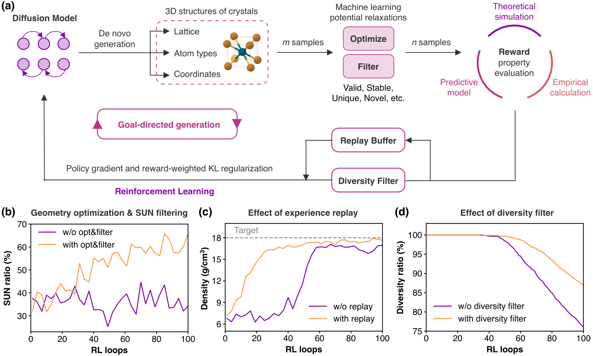

# MatInvent

[MatInvent: Accelerating inverse materials design using generative diffusion models with reinforcement learning](https://arxiv.org/abs/2511.03112)

## Abstract

MatInvent is a general and efficient reinforcement learning workflow that optimizes diffusion models for goal-directed crystal generation. MatInvent enables robust optimization for inverse material design tasks with single or multiple target properties. Compatible with diverse diffusion model architectures and property constraints, MatInvent could offer broad applicability in materials discovery.



---

## Model Description

### Overview

MatInvent adapts pretrained crystal diffusion models for goal-directed materials generation through reinforcement learning. Each round generates crystal structures, evaluates their properties, and fine-tunes the generator using the resulting rewards. The implementation supports MatterGen and DiffCSP backbones, and both are registered models of the structure generation task.

| Backbone | Generation task | Config |
| --- | --- | --- |
| MatterGen | Joint generation of atom types, coordinates, and lattice | [matinvent_mattergen_mp20.yaml](matinvent_mattergen_mp20.yaml) |
| DiffCSP | Coordinate and lattice generation with fixed atom types | [matinvent_diffcsp_mp20.yaml](matinvent_diffcsp_mp20.yaml) |
| DiffCSP | Joint generation of atom types, coordinates, and lattice | [matinvent_diffcsp_mp20_joint.yaml](matinvent_diffcsp_mp20_joint.yaml) |

The MatterGen and fixed-composition DiffCSP configurations optimize density. The joint DiffCSP configuration optimizes the Herfindahl-Hirschman Index (HHI) for supply risk, with relaxation, stability, novelty, and uniqueness screening. Reward properties and targets are configurable.

### Framework integration

| Config block | Content |
| --- | --- |
| `Model` | `MatinventMatterGen` or `MatinventDiffCSP`, with noise schedulers and the RL recipe in `training_cfg` (referencing `Global.training_cfg`) |
| `Optimizer` | The reward-weighted fine-tuning optimizer |
| `Dataset` | RL timestep indices for training; MP-20 validation and test splits |
| `Trainer` | Unmodified `BaseTrainer`, with standard optimization and checkpoint settings |
| `Sample` | Sampling dataset and diffusion step budget |

One epoch is one RL round. The model's `before_train(trainer)` hook initializes the frozen prior, reward calculators and replay state. Each training `forward` returns one timestep objective; the unmodified `BaseTrainer` owns backward, gradient accumulation, optimizer updates, validation and checkpoints. An RL monitor uses the existing streaming-metric callbacks to report rewards and check early-stop probes after optimizer updates. Evaluation and sampling use the diffusion backbone without initializing RL resources.

`MatInventStepDataset` supplies only ordered timestep indices. Its round length includes padding to finish each accumulation group before the next fine-tuning pass. Padding contributes no gradient, and incomplete groups use their actual number of timesteps. `Trainer.gradient_accumulation_steps` references `Global.training_cfg.finetune_cfg.accum_steps`.

Training anchors use a separate `MP20Dataset`, configured through `training_cfg.anchor_cfg.data_cfg` and loaded only when the anchor loss or a fallback early-stop probe needs it. Disabled anchor and probe paths do not build unused batches. Material structures are never fetched by the timestep loader.

Training is single-process, float32, and uses ordered batches of one dataset item with `num_workers=0`. Step-based evaluation, step-based saving and `Trainer.max_iter` remain unsupported. A round with neither scored structures nor replay samples raises an error before optimization, so it cannot silently update optimizer momentum on an empty objective.

### Method

For a generated structure with reward $r$, fine-tuning minimizes the reward-weighted diffusion objective with regularization toward a frozen pretrained prior:

$$
\mathcal{L} = r\,\mathcal{L}_{\mathrm{diff}} + \sigma\,(1.1-r)\,\mathcal{L}_{\mathrm{prior}}.
$$

Both DiffCSP configurations additionally use a denoising loss on MP-20 training structures to reduce distribution drift. Fixed-composition DiffCSP uses a fixed anchor batch; joint DiffCSP resamples training anchors at each anchor loss computation while keeping its validation probe fixed.

Here, $\mathcal{L}_{\mathrm{diff}}$ combines the coordinate, lattice, and, for joint generation, atom-type denoising losses. $\mathcal{L}_{\mathrm{prior}}$ measures the mean squared difference between the agent and prior predictions on the same explicitly shared noisy structure at each time step; $\sigma$ controls its weight.

Structures are ranked by reward before fine-tuning. A replay buffer retains high-reward structures, while a composition-based diversity filter reduces rewards for repeatedly generated compositions. The agent and frozen prior are initialized from the same pretrained backbone.

---

## Dataset Description

RL training uses generated structures and property rewards. Both DiffCSP configurations additionally use MP-20 training structures as denoising anchors. The RL sampling dataset is built from `Model.__init_params__.training_cfg.sample_cfg.data_cfg` through the standard dataloader factory. Density tasks draw atom counts from the Alex-MP-20 distribution; joint DiffCSP uses the MP-20 distribution. Fixed-composition DiffCSP additionally draws atom types before each RL sample; public inference supplies the composition through the input dataset or chemical formula.

| Data | Usage | Source |
| --- | --- | --- |
| Generated crystals | Online reward evaluation and fine-tuning | Current diffusion model |
| Pretrained backbones | Agent and frozen-prior initialization | Registered MatInvent packages; original checkpoints are available on [Hugging Face](https://huggingface.co/jwchen25/MatInvent) |
| MP-20 training structures | DiffCSP denoising anchors | [MP-20](https://paddle-org.bj.bcebos.com/paddlematerial/datasets/mp_20/mp_20.zip) |
| MP-20 validation structures | Validation loss and early-stop probe | [MP-20](https://paddle-org.bj.bcebos.com/paddlematerial/datasets/mp_20/mp_20.zip) |
| MP2020-corrected reference database | Joint DiffCSP stability and novelty screening | [reference_MP2020correction.gz](https://huggingface.co/jwchen25/MatInvent/blob/main/reference_MP2020correction.gz) |

The MP-20 anchor split is declared in `training_cfg.anchor_cfg.data_cfg`; validation and test splits are declared in the `Dataset` block. For joint DiffCSP training, place the reference archive at `data/matinvent/reference_MP2020correction.gz` or update `qualification_cfg.reference_path` under `Model.__init_params__.training_cfg`. Relaxation uses the registered `mattersim_5M` model.

Rewards use `PyMatGen` for built-in properties or `ExternalResults` for values computed by an external workflow. `ExternalResults` exports ordered CIF files and reads one value per structure from `results.txt` in a directory identified by the task and structure content. Earlier `DFTCalc` and `FairChem` calculator configurations should use `ExternalResults`; the external computation remains caller-owned.

---

## Results

| Model | Val loss | Density (g/cm^3) | Valid (%) | Target success (%) | Mean reward | Config | Initialization |
| --- | ---: | ---: | ---: | ---: | ---: | --- | --- |
| matinvent_mattergen_mp20 | 0.3854 | 7.571 | 80.21 | 49.48 | 0.5322 | [config](matinvent_mattergen_mp20.yaml) | [pretrained checkpoint](https://paddle-org.bj.bcebos.com/paddlematerials/checkpoints/structure_generation/MatInvert/matinvent_mattergen_mp20.zip) |
| matinvent_diffcsp_mp20 | 0.9735 | 11.522 | 30.73 | 29.69 | 0.2843 | [config](matinvent_diffcsp_mp20.yaml) | [pretrained checkpoint](https://paddle-org.bj.bcebos.com/paddlematerials/checkpoints/structure_generation/MatInvert/matinvent_diffcsp_mp20.zip) |

| Model | Val loss | HHI | Valid (%) | Qualified (%) | Target success (%) | Config | Initialization |
| --- | ---: | ---: | ---: | ---: | ---: | --- | --- |
| matinvent_diffcsp_mp20_joint | 1.0039 | 3231.84 | 82.81 | 15.10 | 0.52 | [config](matinvent_diffcsp_mp20_joint.yaml) | [pretrained checkpoint](https://paddle-org.bj.bcebos.com/paddlematerials/checkpoints/structure_generation/MatInvert/matinvent_diffcsp_mp20_joint.zip) |

Historical RL checkpoint results; the revised configuration and checkpoint handling have not been evaluated for these metrics. Links provide initialization weights.

Rates use all requested samples; density/HHI means use valid/qualified structures. Success: density >= 5 g/cm^3 or qualified HHI <= 1250.

---

## Command

### Training
```bash
# MatterGen backbone
python structure_generation/train.py -c structure_generation/configs/matinvent/matinvent_mattergen_mp20.yaml

# DiffCSP backbone with fixed atom types
python structure_generation/train.py -c structure_generation/configs/matinvent/matinvent_diffcsp_mp20.yaml

# Joint DiffCSP generation; prepare the reference database first
python structure_generation/train.py -c structure_generation/configs/matinvent/matinvent_diffcsp_mp20_joint.yaml
```

RL checkpoints use the standard `.pdparams`, `.pdopt` and `.pdstates` files. The model stores its frozen prior, replay buffer, long-term memory, anchor/probe batches, the DiffCSP wrapped-noise normalization table and early-stop state in the `_matinvent_training` entry of `.pdparams`; no companion `.rlstate` file is needed. Set `Trainer.resume_from_checkpoint` to the checkpoint prefix without `.pdparams`. Resume continues at the next round, following BaseTrainer's epoch-based behavior.

The native packages omit unused DiffCSP property projections and MatterGen energy heads. Rebuild older packages offline by removing those state entries; retained tensors require no numerical conversion. The model has no legacy-key conversion or filtering branch. Older RL runs with separate `.rlstate` files can initialize backbone weights through `Trainer.pretrained_model_path`, which starts a new RL run. Exact RL resume requires a new checkpoint containing `_matinvent_training`; older sidecars must not be silently discarded during resume.

### Validation

Evaluate the diffusion loss on the `Dataset.val` split:

```bash
python structure_generation/train.py -c structure_generation/configs/matinvent/matinvent_mattergen_mp20.yaml Global.do_train=False Global.do_eval=True
```

During training, each round also reports rewards, scored structure counts, density/HHI statistics and diversity metrics through the framework logger and enabled visualisation backends.

### Testing

Evaluate the diffusion loss on the `Dataset.test` split:

```bash
python structure_generation/train.py -c structure_generation/configs/matinvent/matinvent_mattergen_mp20.yaml Global.do_train=False Global.do_test=True
```

The configurations do not define a task metric, so `sample.py --mode=compute_metric` is not available.

### Sample
```bash
# Predict crystal structures using a trained model.
# Mode 1: Use a pre-trained model (downloads automatically).
# Mode 2: Use a custom configuration file and checkpoint.
# Results are saved to the folder specified by --output_path (default: results).

# Mode 1: pre-trained MatterGen backbone
python structure_generation/sample.py --model_name='matinvent_mattergen_mp20' --output_path='result_matinvent_mattergen/' --mode='by_dataloader'

# Mode 2: MatterGen checkpoint produced by an RL run
python structure_generation/sample.py --config_path='structure_generation/configs/matinvent/matinvent_mattergen_mp20.yaml' --checkpoint_path='<run_dir>/checkpoints/epoch_10.pdparams' --output_path='result_matinvent_mattergen/' --mode='by_dataloader'

# Mode 2: fixed-composition DiffCSP checkpoint; the formula supplies the atom types
python structure_generation/sample.py --config_path='structure_generation/configs/matinvent/matinvent_diffcsp_mp20.yaml' --checkpoint_path='<run_dir>/checkpoints/epoch_10.pdparams' --output_path='result_matinvent_diffcsp/' --mode='by_chemical_formula' --chemical_formula='LiMnO2'
```

---

## Citation
```
@article{matinvent,
  title={Accelerating inverse materials design using generative diffusion models with reinforcement learning},
  author={Chen, Junwu and Guo, Jeff and Fako, Edvin and Schwaller, Philippe},
  journal={arXiv preprint arXiv:2511.03112},
  year={2025}
}
```
