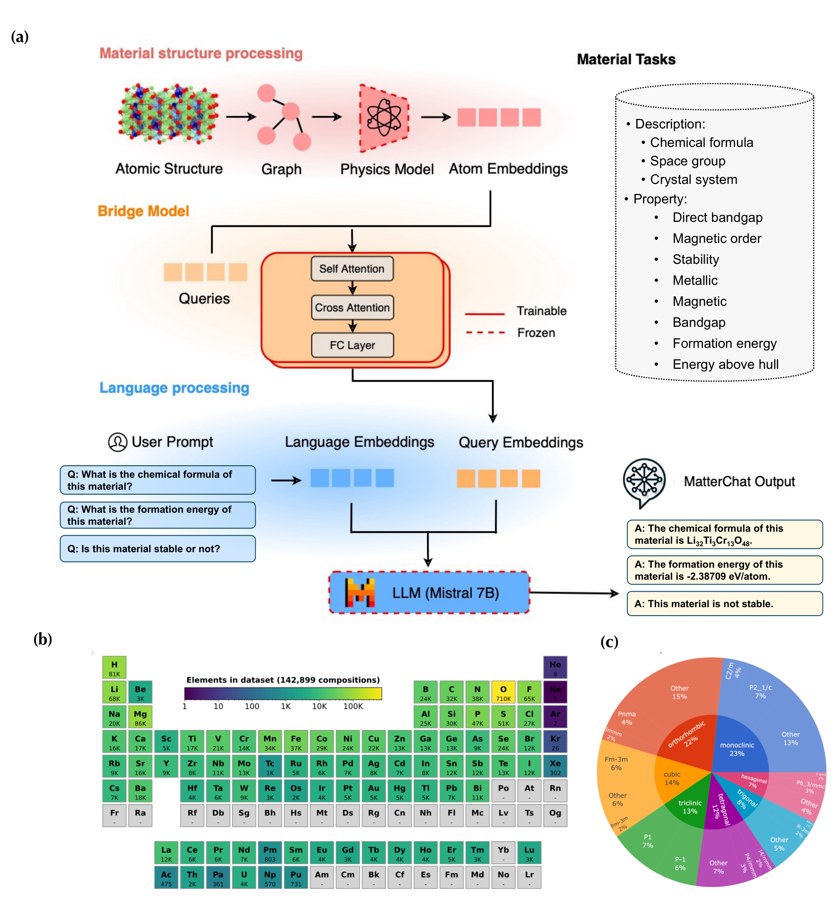

# MatterChat

[MatterChat: A Multi-Modal LLM for Material Science](https://arxiv.org/abs/2502.13107)

## Abstract

MatterChat answers questions about crystal structures by connecting a frozen CHGNet material encoder to a frozen Mistral language model through a trainable Q-Former and linear projection. The public interface accepts a pymatgen `Structure` and a question, and returns a text answer. Answers may describe composition, symmetry, stability, or electronic properties; they are model predictions rather than verified physical labels.



## Model Description

### Overview

```text
Structure -> CHGNet -> per-atom features [N, 64]
          -> Q-Former -> query features [32, 768]
          -> Linear -> material prefix [32, 4096]
          -> Mistral + question -> answer
```

The implementation supports dialogue inference and supervised bridge fine-tuning on precomputed material features. It does not implement the paper's complete multi-stage training pipeline or retrieval-augmented generation.

### Method

CHGNet constructs a periodic graph and produces a feature for each atom. Learnable query tokens attend to these features through the Q-Former. A linear projection maps the resulting queries into the Mistral embedding space. The projected material prefix and question embeddings condition autoregressive answer generation.

During training, **CHGNet and the entire LLM remain frozen**. Only the Q-Former, query tokens, and projection are optimized. Gradients still pass through the frozen LLM to the material prefix. The loss supervises answer tokens, including EOS, and masks the material prefix, question, and padding tokens. The training configuration initializes all modules from a local pretrained MatterChat package before the optimizer is constructed.

`material_encoder_config`, `qformer_config`, and `llm_config` configure the three components. The default dimensions match the released checkpoint. The released Q-Former is query-only and requires `qformer_text_input: false`. `attn_implementation` accepts `eager` or `sdpa`. A pure Python tokenizer reads the package's `tokenizer.json`; no external tokenizer framework is required. It supports the released Metaspace/BPE tokenizer with byte fallback and the WordLevel test fixture.

## Dataset Description

Inference accepts structures directly. Bridge training uses caller-provided question-answer records and frozen CHGNet features; this integration does not distribute a training corpus or fixed splits.

| Dataset | Train | Validation | Test |
| --- | --- | --- | --- |
| Local crystal question-answer NPZ archives | Caller-defined | Caller-defined | Caller-defined |

Prepare independent `train.npz`, `val.npz`, and `test.npz` archives under `./data/matterchat/`. Each archive contains these arrays without pickle objects:

| Array | Shape | Type | Description |
| --- | --- | --- | --- |
| `material_embedding` | `[sum(num_atoms), 64]` | float32 | Per-atom features concatenated in record order |
| `num_atoms` | `[records]` | integer | Positive atom count for each record |
| `text_input` | `[records]` | Unicode string | Question |
| `text` | `[records]` | Unicode string | Nonempty answer without manually added BOS/EOS |

Use the same frozen encoder weights for feature extraction and inference. Load the pretrained model, call `model.eval()`, and obtain each record's features with `model.material_encoder.predict_structure_embedding(structure)` under `paddle.no_grad()`. Concatenate features with `numpy.concatenate` and save the four arrays with `numpy.savez`. Split records before preparing archives. Custom encoder widths require matching weights, regenerated features, and the dataset's `embedding_dim` setting.

`MatterChatDataset` returns a plain dictionary and uses `ConcatData` with `DefaultCollator` for variable atom counts. The model pads material features and masks padded atoms before cross-attention.

## Results

| Model | Dataset | Evaluation | Config | Checkpoint |
| --- | --- | --- | --- | --- |
| MatterChat | Crystal question-answer examples | Qualitative dialogue examples below | [Inference](matterchat_full.yaml) | [Pretrained package](https://paddle-org.bj.bcebos.com/paddlematerials/checkpoints/llm/MatterChat/matterchat_full.zip) |
| MatterChat bridge fine-tuning | Local crystal question-answer NPZ | Training and resume integration coverage; convergence unverified | [Training](matterchat_train.yaml) | Initialized from the pretrained package |

Historical greedy FP32 outputs from the converted checkpoint are shown below. These are generated answers, not benchmark accuracy or verified reference labels.

| Crystal | Formula | Space group | Stable | Band gap |
| --- | --- | --- | --- | --- |
| Si | Si | Cm | No | 0.00000 |
| GaN | GaN | P6_3mc | No | 1.83095 |

The Si example uses two atoms in a cubic cell with lattice parameter 5.43 angstrom and fractional coordinates `(0, 0, 0)` and `(0.25, 0.25, 0.25)`. The GaN example uses a four-atom hexagonal cell with `a=3.189` and `c=5.185` angstrom.

A historical full-size bridge smoke run used eight training records, four validation records, and eight optimizer updates. All 257 trainable tensors had finite gradients, and frozen tensors remained unchanged. At learning rate `1e-4`, training loss increased from 0.088473 to 0.124636 and validation loss from 0.138993 to 0.190809. A separate eight-update run at `1e-6` ended at training loss 0.079523 and validation loss 0.136412. These small runs establish workflow feasibility and do not establish convergence or fine-tuning quality.

## Command

### Training

```bash
python structure_generation/train.py \
  -c structure_generation/configs/matterchat/matterchat_train.yaml
```

Place the local pretrained MatterChat package at `./data/matterchat/matterchat_full`, or point `Model.__init_params__.pretrained_package` to its existing directory. The configuration loads that local package before training and keeps CHGNet and Mistral frozen. It does not download weights by default. The default dataset is `./data/matterchat/train.npz`. The package tokenizer is selected automatically; `tokenizer_path` may explicitly select a matching tokenizer file. Keep `Trainer.pretrained_model_path=null` when using the model's package initialization. An explicit registered name is also accepted for package initialization.

Resume with `Trainer.resume_from_checkpoint=<checkpoint_prefix>` using the actual timestamped run directory and a prefix such as `checkpoints/latest`, without a file extension. Full-size training needs additional memory for gradients through the frozen LLM even though its parameters are not updated.

### Validation

```bash
python structure_generation/train.py \
  -c structure_generation/configs/matterchat/matterchat_train.yaml \
  Global.do_train=False Global.do_eval=True \
  Dataset.val.dataset.__class_name__=MatterChatDataset \
  Dataset.val.dataset.__init_params__.path=./data/matterchat/val.npz \
  Dataset.val.sampler.__class_name__=BatchSampler \
  Dataset.val.sampler.__init_params__.batch_size=2 \
  Dataset.val.sampler.__init_params__.shuffle=False \
  Dataset.val.sampler.__init_params__.drop_last=False
```

### Testing

```bash
python structure_generation/train.py \
  -c structure_generation/configs/matterchat/matterchat_train.yaml \
  Global.do_train=False Global.do_test=True \
  Dataset.test.dataset.__class_name__=MatterChatDataset \
  Dataset.test.dataset.__init_params__.path=./data/matterchat/test.npz \
  Dataset.test.sampler.__class_name__=BatchSampler \
  Dataset.test.sampler.__init_params__.batch_size=2 \
  Dataset.test.sampler.__init_params__.shuffle=False \
  Dataset.test.sampler.__init_params__.drop_last=False
```

Validation and testing evaluate answer-token cross-entropy, not factual question-answer accuracy.

### Sample

Dialogue sampling produces text through `chat()`:

```python
from pymatgen.core import Structure

from ppmat.models import Blip2MistralInstruct

model = Blip2MistralInstruct.from_pretrained("./data/matterchat/matterchat_full")
model.eval()
structure = Structure.from_file("Si.cif")
print(model.chat(structure, "what is the chemical formula of this material?"))
```

`Blip2MistralInstruct.from_pretrained()` also accepts the registered name `matterchat_full`. `build_model_from_name("matterchat_full")` supports the standard native package through the common registry loading path. New packages use `matterchat_full.yaml`, `tokenizer.json`, and `checkpoints/best.pdparams`. The model-specific loader continues to accept legacy indexed shards. For custom checkpoints, load a package with matching architecture and tokenizer. This dialogue model uses its text interface rather than `StructureSampler`.

`chat_batch(structures, prompts, max_new_tokens=64)` returns one answer per crystal and accepts either one shared prompt or an equally sized prompt list. Greedy and nucleus generation support batches; beam search accepts one crystal at a time.

### Execution Backend

Eager execution is the default. The model delegates runtime selection to its Mistral backbone; CHGNet, Q-Former, the language-model head, and generation loops remain eager. For CUDA inference, call `model.set_execution_backend("cinn")` and `model.validate_execution_backend(use_amp=False, world_size=1)` before dialogue. The shared CINN backend requires CUDA and supports neither AMP nor distributed execution.

Historical full-size FP32 inference on a 32 GB GPU required `paddle.set_flags({"FLAGS_enable_fuse_parallel_matmul_pass": False})` before the first CINN call to avoid additional concatenated-weight allocations. The GPU integration test compares greedy eager/CINN outputs and is gated by `PPMAT_RUN_CINN_WORKFLOW_TESTS=1`. CPU runtime-dispatch tests do not establish compiled numerical equivalence. Compiled training is not qualified by this integration.

## Citation

```bibtex
@misc{matterchat2025,
  title={MatterChat: A Multi-Modal LLM for Material Science},
  author={Yingheng Tang and Wenbin Xu and Jie Cao and Weilu Gao and
          Steve Farrell and Benjamin Erichson and Michael W. Mahoney and
          Andy Nonaka and Zhi Yao},
  year={2025},
  eprint={2502.13107},
  archivePrefix={arXiv},
  primaryClass={cs.AI},
  url={https://arxiv.org/abs/2502.13107}
}
@article{li2023blip,
  title={Blip-2: Bootstrapping language-image pre-training with frozen image encoders and large language models},
  author={Li, Junnan and Li, Dongxu and Savarese, Silvio and Hoi, Steven},
  journal={arXiv preprint arXiv:2301.12597},
  year={2023}
}
```
