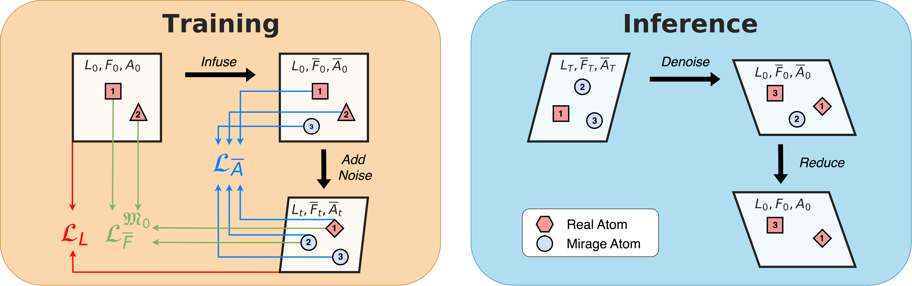

# MiAD

[Mirage Atom Diffusion for De Novo Crystal Generation](https://arxiv.org/abs/2511.14426)

## Abstract

MiAD introduces Mirage Infusion, a mechanism that allows diffusion models to dynamically adjust the number of atoms in a crystal structure during the generation trajectory. By treating a variable number of atoms as "mirage" atoms (sentinel states), MiAD achieves state-of-the-art performance in generating stable, unique, and novel (S.U.N.) materials. It uses DiffCsp as the backbone denoising architecture.



---

## Model Description

### Overview

A crystal is represented by three components within its unit cell:

- atom types: $A = (a_1,\ldots,a_N)$
- fractional coordinates: $F = (f_1,\ldots,f_N),\; f_i \in [0,1)^3$
- lattice matrix: $L \in \mathbb{R}^{3 \times 3}$

MiAD defines separate forward corruption processes for $(L, F, A)$ and trains a CSPNet-based denoiser to reverse them. During sampling, mirage atoms (type 0) can be transformed into real elements or discarded, allowing the model to adjust atom counts dynamically.

### Method

#### 1) Lattice diffusion (DDPM on $L$)

The lattice is diffused with a DDPM Gaussian process:

$$
L_t = \sqrt{\bar{\alpha}_t}\,L_0 + \sqrt{1 - \bar{\alpha}_t}\,\epsilon,\quad \epsilon \sim \mathcal{N}(0, I)
$$

Lattice matrices are unbounded, so DDPM sample clipping is disabled.
`CosineDDPMScheduler` constructs the clipped cosine table and reuses the shared
DDPM implementation through `trained_betas`. The three diffusion components use
`lattice_noise_scheduler_cfg`, `coord_noise_scheduler_cfg` and
`atom_noise_scheduler_cfg`. Legacy `lat_diffusion`, `frac_diffusion` and
`type_diffusion` configurations remain supported.

#### 2) Fractional-coordinate diffusion on a torus (wrapped Normal / score matching)

Fractional coordinates live on a 3D torus $[0,1)^3$. Wrapped Normal noise is used:

$$
x_t = (x_0 + \sigma(t)\,\epsilon) \bmod 1,\quad \epsilon \sim \mathcal{N}(0, I)
$$

`WrappedVESDEPCScheduler` owns the score target and predictor-corrector updates.
Its indexed predictor clamps the previous sigma to `sigma_min`, so the final
step has zero drift and diffusion.

#### 3) Periodic E(3)-aware denoiser (EGNN + periodic Fourier features)

MiAD reuses the CSPNet denoiser on a fully connected atom graph. Periodic
Fourier features encode fractional-coordinate differences, and the network
predicts lattice noise, coordinate scores and atom-type logits.

Atom types use D3PM with a uniform transition kernel and a cosine schedule.
`D3PMUniformScheduler` implements the transition tables, forward noising,
reverse sampling, prior sampling and per-atom KL loss.

During sampling, atoms with type 0 are treated as mirage atoms. The model dynamically decides which mirage atoms should materialize into real elements, allowing the final structure to have fewer atoms than the initial maximum. This is the core innovation enabling variable-atom-count generation.

During training, every crystal is padded to `model_cfg.mirage_num_atoms` atoms (configured as 25, matching the official MiAD `add_mirage_atoms_upto25`) by appending type-0 mirage atoms with random fractional coordinates. The coordinate loss masks out mirage atoms and rescales to keep the loss scale.

---

## Dataset Description

MiAD uses the MP-20 CSV splits provided by `MP20Dataset`. Each row contains a
CIF structure and material properties. This unconditional model trains on atom
types, fractional coordinates and lattice matrices; material-property columns
are not conditioning inputs. The configuration converts CIFs to primitive,
Niggli-reduced structures and pads training structures to 25 atoms.

Recommended data fields for each sample:

- `atom_types`: length-$N$ atomic numbers, with type 0 reserved for mirage atoms
- `frac_coords`: $N \times 3$ fractional coordinates in $[0,1)$
- `lattice`: $3 \times 3$ lattice matrix

#### MP-20 split (download link)

| Dataset | Train | Val | Test |
| --- | --- | --- | --- |
| [MP-20](https://paddle-org.bj.bcebos.com/paddlematerial/datasets/mp_20/mp_20.zip) | 27136 | 9047 | 9046 |

Download the [MP-20 archive](https://paddle-org.bj.bcebos.com/paddlematerial/datasets/mp_20/mp_20.zip)
and place `train.csv`, `val.csv` and `test.csv` under `data/mp_20/`.
When a configured split is missing, `MP20Dataset` downloads and extracts the
archive into the framework dataset cache. For novelty evaluation, point
`Sample.metrics.__init_params__.reference_file_path` to the actual training
CSV; the metric requires that explicit file to exist.

---

## Results

| Model | Dataset | Match Rate (%) | RMS Dist | GPUs | Training Time | Config | Checkpoint / Log |
| --- | --- | --- | --- | --- | --- | --- | --- |
| miad_mp20 | mp20 | N/A | N/A | Not recorded | Not recorded | [miad_mp20.yaml](miad_mp20.yaml) | [checkpoint](http://127.0.0.1/models/miad_mp20.zip) |

| Model | Dataset | S.U.N. (%) | Stable (%) | Unique (%) | Novel (%) | RMSD (Å) | GPUs | Training Time | Config | Checkpoint / Log |
| --- | --- | --- | --- | --- | --- | --- | --- | --- | --- | --- |
| miad_mp20 | mp20 | Not evaluated | Not evaluated | Not evaluated | Not evaluated | N/A | Not recorded | Not recorded | [miad_mp20.yaml](miad_mp20.yaml) | [checkpoint](http://127.0.0.1/models/miad_mp20.zip) |

MiAD implements unconditional generation. The composition-conditioned CSP
match rate and RMS distance, and relaxation RMSD, are not implemented (`N/A`).
GPU counts and training time for the linked pretrained checkpoint were not
recorded; short integration runs do not establish full-training cost.

Uniqueness uses cross-sample `StructureMatcher` matching, and novelty compares
against the MP-20 training split with `attempt_supercell=false` and
`symmetric=false`. Stability requires prerelaxation and convex-hull energies,
which are not implemented in this integration. Without `energy_above_hull`,
`SUNMetric` emits zero placeholders for stability and S.U.N.; these are not
measured stability results. The paper's 12.21% S.U.N. result uses a different,
complete evaluation pipeline and is not a PaddleMaterials reproduction.

The registry uses the local nginx endpoint for verification. The production URL
is preserved as a comment beside the registry entry for release maintenance.
For local downloads behind an HTTP proxy, set `NO_PROXY=127.0.0.1,localhost`.

---

## Command

### Training

```bash
# single-gpu training
python structure_generation/train.py -c structure_generation/configs/miad/miad_mp20.yaml
```

### Validation

```bash
# Adjust program behavior on the fly using command-line parameters without modifying the configuration file directly.
# Example: Global.do_eval=True
python structure_generation/train.py -c structure_generation/configs/miad/miad_mp20.yaml Global.do_eval=True Global.do_train=False Global.do_test=False Trainer.pretrained_model_path='path/to/model.pdparams'
```

### Testing

```bash
# Evaluate the model on the test dataset.
python structure_generation/train.py -c structure_generation/configs/miad/miad_mp20.yaml Global.do_eval=False Global.do_train=False Global.do_test=True Trainer.pretrained_model_path='path/to/model.pdparams'
```

### Sample

Sampling uses the complete trained diffusion schedule. `num_inference_steps`
must equal `Model.__init_params__.diffusion_cfg.num_steps` (1000 for the
released checkpoint); timestep respacing is unsupported. The repository YAML
derives the model, all three schedulers and sampling steps from
`Global.num_train_timesteps`. Changing this value defines a new training
schedule and must not be used to shorten sampling with released weights.
The sampling dataloader uses `NumAtomsCrystalDataset` to draw 16 atom capacities
from the MP-20 distribution. Override
`Sample.data.dataset.__init_params__.total_num` to change the number of samples.
This unconditional configuration uses no property names or values.

```bash
# Predict crystal structures using a trained model.
# Mode 1: Use a pre-trained model (downloads automatically).
# Mode 2: Use a custom configuration file and checkpoint.
# Results are saved to the folder specified by --output_path (default: results).

# Mode 1: pre-trained model, sample by number of atoms
# num_atoms is the maximum number of atoms (mirage infusion): the model decides
# how many become real elements, and mirage atoms (type 0) are filtered out.
python structure_generation/sample.py --model_name='miad_mp20' --output_path='result_miad/' --mode='by_num_atoms' --num_atoms=20

# Mode 2: custom config + checkpoint, sample by number of atoms
python structure_generation/sample.py --config_path='structure_generation/configs/miad/miad_mp20.yaml' --checkpoint_path='./output/miad_mp20/checkpoints/latest.pdparams' --output_path='result_miad/' --mode='by_num_atoms' --num_atoms=20

# Mode 1: pre-trained model, sample by dataloader (draws MP-20 atom capacities)
python structure_generation/sample.py --model_name='miad_mp20' --output_path='result_miad/' --mode='by_dataloader'

# Mode 2: custom config + checkpoint, sample by dataloader
python structure_generation/sample.py --config_path='structure_generation/configs/miad/miad_mp20.yaml' --checkpoint_path='./output/miad_mp20/checkpoints/latest.pdparams' --output_path='result_miad/' --mode='by_dataloader'

# Generate from the atom-count dataloader and evaluate with SUNMetric.
# Stability and S.U.N. require external hull energies; see Results.
python structure_generation/sample.py --model_name='miad_mp20' --output_path='result_miad/' --mode='compute_metric'
```

Novelty evaluation requires an existing, non-empty training CSV with a `cif`
column. If MP-20 is in the dataset cache, override
`Sample.metrics.__init_params__.reference_file_path=/path/to/mp_20/train.csv`.
Reference structures are cached in the framework dataset cache or the
explicit metric `cache_dir`. All rates include the full generated population;
an external `energy_above_hull` list must contain one entry per structure.

---

## Citation

```bibtex
@article{okhotin2025miad,
  title={MiAD: Mirage Atom Diffusion for De Novo Crystal Generation},
  author={Andrey Okhotin, Maksim Nakhodnov, Nikita Kazeev, Andrey E Ustyuzhanin, Dmitry Vetrov},
  journal={arXiv preprint arXiv:2511.14426},
  year={2025},
  url={https://arxiv.org/abs/2511.14426}
}
```
