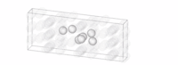

# OMatG

[Open Materials Generation with Stochastic Interpolants](https://arxiv.org/abs/2502.02582)

## Abstract

OMatG generates inorganic crystal structures with stochastic interpolants,
supporting crystal structure prediction (CSP) and de novo generation (DNG).




## Model Description

### Overview

- **CSP:** generates fractional coordinates and lattice vectors for a fixed composition.
- **DNG:** additionally generates atomic species from masked tokens.

### Method

Continuous fields follow stochastic interpolants:

$$
x_t = \alpha(t)x_0 + \beta(t)x_1 + \gamma(t)z,
\qquad z \sim \mathcal{N}(0, I).
$$

The DiffCSP backbone predicts velocity and denoising fields. Sampling uses Euler
integration with periodic fractional coordinates; DNG species use discrete flow
matching. Interpolants and integration settings are configured per field in YAML.

## Dataset Description

| Dataset | Train | Val | Test |
| --- | --- | --- | --- |
| [MP-20](https://paddle-org.bj.bcebos.com/paddlematerial/datasets/mp_20/mp_20.zip) | 27136 | 9047 | 9046 |

## Results

Converted upstream pretrained checkpoints, evaluated with seed 42, batch size 128
and eager execution against the 9046 MP-20 test structures:

- CSP: 9046 compositions, 210 integration time points.
- DNG: 1000 samples, MP-20 atom-count distribution, 710 integration time points.

| Model | Dataset | Match Rate (%) | RMS Dist | Config | Checkpoint |
| --- | --- | --- | --- | --- | --- |
| omatg_mp20_csp_linear_ode | mp20 | 63.82 | 0.0712 | [omatg_mp20_csp.yaml](omatg_mp20_csp.yaml) | [checkpoint](https://paddle-org.bj.bcebos.com/paddlematerials/checkpoints/structure_generation/OMatG/omatg_mp20_csp_linear_ode.zip) |

| Model | Dataset | Valid (%) | Struct. Valid (%) | COV-P (%) | COV-R (%) | METRe (%) | wDist (rho) | wDist (N-ary) | wDist (CN) | Config | Checkpoint |
| --- | --- | --- | --- | --- | --- | --- | --- | --- | --- | --- | --- |
| omatg_mp20_dng_linear_sde_gamma | mp20 | 83.10 | 98.70 | 98.50 | 95.89 | 0.177 | 0.2415 | 0.0443 | 0.5501 | [omatg_mp20_dng.yaml](omatg_mp20_dng.yaml) | [checkpoint](https://paddle-org.bj.bcebos.com/paddlematerials/checkpoints/structure_generation/OMatG/omatg_mp20_dng_linear_sde_gamma.zip) |

CSP RMS Dist averages matched pairs. DNG `Valid` includes composition, structure,
polar-sine and fingerprint checks; `Struct. Valid` covers structural checks alone.
COV retains invalid samples in its precision denominator; METRe measures reference
coverage by structure matching. wDist compares density, distinct element count and
mean coordination number over constructible structures.

Local training verification: CSP 50 epochs, DNG 20 epochs. The results above use
the converted pretrained weights.

---

## Command

### Training

Configurations load pretrained weights by default. Train from scratch with:

```bash
python structure_generation/train.py -c structure_generation/configs/omatg/omatg_mp20_csp.yaml Trainer.pretrained_model_path=null
```

Use `omatg_mp20_dng.yaml` for de novo generation training.

### Validation

```bash
python structure_generation/train.py -c structure_generation/configs/omatg/omatg_mp20_csp.yaml Global.do_train=False Global.do_eval=True
```

### Testing

```bash
python structure_generation/train.py -c structure_generation/configs/omatg/omatg_mp20_csp.yaml Global.do_train=False Global.do_eval=False Global.do_test=True
```

### Sample

```bash
python structure_generation/sample.py --model_name=omatg_mp20_csp_linear_ode --mode=by_chemical_formula --chemical_formula=LiMnO2
```

### Evaluation

```bash
python structure_generation/sample.py --model_name=omatg_mp20_csp_linear_ode --mode=compute_metric Sample.data.sampler.__init_params__.batch_size=128
```

For DNG evaluation, use `--model_name=omatg_mp20_dng_linear_sde_gamma`.

---

## Citation

```
@article{hoellmer2025open,
  title={Open Materials Generation with Stochastic Interpolants},
  author={Hoellmer, Philipp and Egg, Thomas and Martirossyan, Maya M. and Fuemmeler, Eric and Shui, Zeren and Gupta, Amit and Prakash, Pawan and Roitberg, Adrian and Liu, Mingjie and Karypis, George and Transtrum, Mark and Hennig, Richard G. and Tadmor, Ellad B. and Martiniani, Stefano},
  journal={arXiv preprint arXiv:2502.02582},
  year={2025}
}
```
