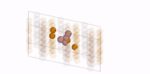

# OMatG

[Open Materials Generation with Stochastic Interpolants](https://openreview.net/forum?id=gHGrzxFujU)
uses stochastic interpolants for crystal structure prediction (CSP) and de novo
generation (DNG). The implementation reuses the DiffCSP message-passing layers,
`DefaultCollator`, `BaseTrainer` and `StructureSampler`.

| Configuration | Registered package | Species | Continuous integration |
| --- | --- | --- | --- |
| [omatg_mp20_csp.yaml](omatg_mp20_csp.yaml) | `omatg_mp20_csp_linear_ode` | fixed input composition | Linear ODE, Euler |
| [omatg_mp20_dng.yaml](omatg_mp20_dng.yaml) | `omatg_mp20_dng_linear_sde_gamma` | masked discrete flow matching | Linear SDE with square-root gamma, Euler-Maruyama |

Coordinates are fractional and periodic; cell matrices evolve in Cartesian
space. Each integration step computes all fields from the same previous state.
SDE drift includes the configured velocity annealing, and masked species are
fully unmasked at the final step. Integration uses one fixed Euler step per
interval; adaptive solvers and SDE substeps are unsupported. Nonempty
`integrator_kwargs` must be `{"method": "euler"}`.

The released packages contain auxiliary prediction heads that their selected
losses never use. These tensors remain in `state_dict` and are frozen; active
heads retain their original checkpoint names and shapes. OMatG uses the shared
unfused Swish expression to avoid nonfinite fused-SiLU CPU gradients at large
negative inputs.

### Examples from the original project




## Data

`OMATGStructureDataset` accepts an explicit `path` (`file_path` remains a
legacy keyword alias):

| Format | Required fields | Loading |
| --- | --- | --- |
| LMDB | `cell` (3x3), `atomic_numbers` (N), Cartesian `pos` (Nx3) | lazy by default; metadata keys beginning with `__` are excluded |
| CSV | `cif` | eager; structures are parsed through `BuildStructure` |
| Parquet | `cell`, `atomic_numbers`, Cartesian `positions` | eager |

`convert_to_fractional=True` converts Cartesian input once. CSV coordinates
are already fractional. Optional Niggli reduction defaults to false. All formats
return plain dictionaries of `ConcatData` fields for `DefaultCollator`.

The training configurations expect `data/mp_20/{train,val,test}.lmdb` prepared
from the original OMatG data. Pickled LMDB payloads must contain NumPy arrays or
Python lists; source payloads containing PyTorch tensors require conversion
before use. Alternatively, obtain the repository's MP-20 CSV package and set
each `Dataset` split's `path` to its CSV:

```bash
mkdir -p data/mp_20
wget -O data/mp_20/mp_20.zip https://paddle-org.bj.bcebos.com/paddlematerial/datasets/mp_20/mp_20.zip
unzip -j data/mp_20/mp_20.zip -d data/mp_20
```

The archive MD5 is `73371948155aa9da609436e291142d7e`. This dataset adapter
does not infer resource locations or download files implicitly. Metric references
must be CSV files with a `cif` column. CSP predictions and references must follow
the same row order and preprocessing; LMDB key order must not be assumed to equal
CSV row order.

## Environment

Use the repository's Paddle environment and dependencies. LMDB input requires
`lmdb`; Parquet requires a pandas Parquet engine such as `pyarrow`. Evaluation
uses pymatgen, matminer, SMACT, ASE and SciPy. No PyTorch runtime is required.

## Training and evaluation

Run a bounded smoke test on prepared LMDB data:

```bash
python structure_generation/train.py \
    -c structure_generation/configs/omatg/omatg_mp20_csp.yaml \
    Trainer.max_epochs=1 Trainer.max_iter=2 Global.do_eval=False \
    Dataset.train.sampler.__init_params__.batch_size=2 \
    Dataset.val.sampler.__init_params__.batch_size=2
```

Use `omatg_mp20_dng.yaml` for DNG. Omit the overrides for the full configured
training run. `Global.do_eval=False` skips the final standalone evaluation;
validation during training still follows `Trainer.eval_freq`.

Evaluate a trained checkpoint on the validation split:

```bash
python structure_generation/train.py \
    -c structure_generation/configs/omatg/omatg_mp20_csp.yaml \
    Global.do_train=False Global.do_eval=True \
    Trainer.pretrained_model_path=./output/omatg_run/checkpoints/best.pdparams
```

Use the actual run directory: the training entrypoint appends a timestamp and
seed to `Trainer.output_dir`. For the test split, replace `Global.do_eval=True`
with `Global.do_eval=False Global.do_test=True`. To fine-tune, provide
`Trainer.pretrained_model_path` while leaving `Global.do_train=True`.

The existing Trainer saves epoch checkpoints before advancing an epoch-based
learning-rate scheduler. Resuming the provided Cosine schedules therefore
restores a scheduler one epoch behind an uninterrupted run. The shared Trainer
is unchanged by this integration. The resume integration test uses a nonconstant
step-based scheduler and checks weights, Adam moments, learning rate and global
step before the first resumed update; it does not qualify exact epoch-based
scheduler continuation. Loading model weights for inference is unaffected.

## Pretrained sampling

The two registered packages include configuration and `checkpoints/best.pdparams`.
The framework downloads and loads them automatically:

```bash
python structure_generation/sample.py \
    --model_name omatg_mp20_csp_linear_ode \
    --mode by_chemical_formula --chemical_formula LiMnO2 \
    --output_path ./results/omatg_csp

python structure_generation/sample.py \
    --model_name omatg_mp20_dng_linear_sde_gamma \
    --mode by_num_atoms --num_atoms 8 \
    --output_path ./results/omatg_dng
```

For local weights, replace `--model_name` with `--config_path` and
`--checkpoint_path`. With CSP, `by_num_atoms` draws random atomic species and
then keeps them fixed; use `by_chemical_formula` for a prescribed composition.
Sampling step counts can be set with
`Sample.model_sample_params.num_inference_steps=210` (CSP) or `710` (DNG).
The local configurations share their 210/710 grid points with the SI settings.
The older published packages explicitly use 100 grid points for a shorter run.

`OMATG_WEIGHTS` retains the original raw-weight download index. Its legacy
`build_omatg_model` helper builds a backbone for forward evaluation; sampling
requires an explicitly supplied, matching `si_scheduler_cfg` and `sampler_cfg`.
The supplied SI implementation covers the two configurations above. Trig,
EncDec, VESBD and VPSBD sampling schedules are not implemented here; changing
only a dataset path does not configure those variants.

## Metrics and validation scope

`OMatGMetric(metric_type="match")` computes per-index CSP matching and RMSD.
`metric_type="dng"` computes validity, METRe reference coverage, Wasserstein
statistics and composition/structure fingerprint coverage. Invalid predictions
remain in validity and coverage denominators. More generated structures than
references are allowed for DNG. Distribution distances exclude structures that
cannot be constructed; if none can be constructed, only validity is reported.
One-shot and streaming evaluation share the same implementation, and global
reference matching includes predictions from all batches.

Use the local CSP configuration's CSV sampling dataset for paired matching.
Its `Sample.data.dataset.__init_params__.path` and
`Sample.metrics.__init_params__.gt_file_path` refer to the same CSV. A legacy downloaded package may still configure a random
atom-count dataset; use the local configuration with the downloaded checkpoint
for paired evaluation. DNG references need not be paired with generated rows.

```bash
python -m pytest test/omatg/test_omatg.py -v
```

The integration suite covers CSP/DNG training, finite gradients and optimizer
updates, masked-species sampling, simultaneous SI updates, CSV/LMDB/Parquet data
flow, configuration validation, metric failure accounting and streaming,
backend dispatch, and Trainer checkpoint restoration.

CINN uses the model-owned `denoise_step` boundary. CPU dispatch tests exercise
orchestration; they do not establish GPU compilation correctness. GPU training
and registered-checkpoint sampling qualification remains pending after the
sampling and activation corrections. Set `PPMAT_RUN_CINN_WORKFLOW_TESTS=1` on a
working CUDA/CINN machine to run the gated training comparison. OMatG timings
are not included in the shared A100 performance matrix.

Paper-level generation quality and full-data convergence have not been
reproduced by these smoke tests. Historical backbone-forward comparisons are
separate from sampling correctness and must not be used as evidence that every
archived variant reproduces the paper's generation results.

## Citation

```bibtex
@inproceedings{
    hoellmer2025,
    title={Open Materials Generation with Stochastic Interpolants},
    author={Philipp H{\"o}llmer and Thomas Egg and Maya Martirossyan and Eric
    Fuemmeler and Zeren Shui and Amit Gupta and Pawan Prakash and Adrian
    Roitberg and Mingjie Liu and George Karypis and Mark Transtrum and Richard
    Hennig and Ellad B. Tadmor and Stefano Martiniani},
    booktitle={Forty-second International Conference on Machine Learning},
    year={2025},
    url={https://openreview.net/forum?id=gHGrzxFujU},
    archivePrefix={arXiv},
    eprint={2502.02582},
    primaryClass={cs.LG},
}
```

```bibtex
@inproceedings{
    martirossyan2025,
    title={All that structure matches does not glitter},
    author={Maya Martirossyan and Thomas Egg and Philipp H{\"o}llmer
    and George Karypis and Mark Transtrum and Adrian Roitberg
    and Mingjie Liu and Richard Hennig and Ellad B. Tadmor and Stefano Martiniani},
    booktitle={Thirty-Ninth Annual Conference on Neural Information Processing Systems},
    year={2025},
    url={https://openreview.net/forum?id=ig9ujp50D4},
    archivePrefix={arXiv},
    eprint={2509.12178},
    primaryClass={cs.LG},
}
```
