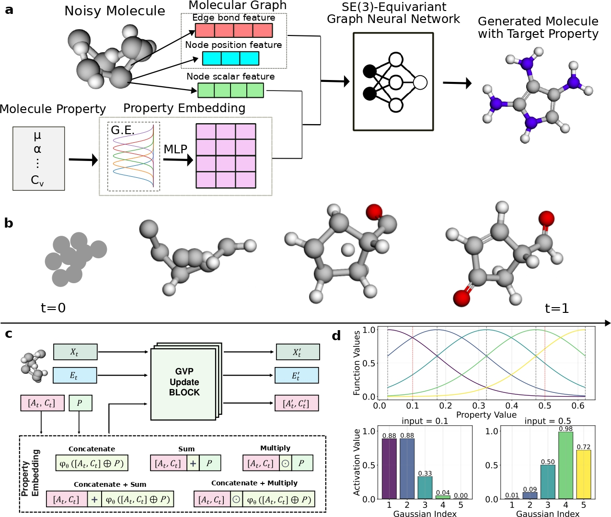

# PropMolFlow

[PropMolFlow: property-guided molecule generation with geometry-complete flow matching](https://www.nature.com/articles/s43588-025-00946-y)

## Abstract

PropMolFlow generates molecules conditioned on a target property using geometry-complete SE(3)-equivariant flow matching. A geometric vector perceptron network jointly predicts atomic coordinates, atom types, formal charges and bond types. Continuous coordinates follow a Gaussian-to-data interpolation, while discrete features follow masked continuous-time Markov chains. This implementation provides the MLP property embedding used by the released checkpoints; the default configuration conditions on polarizability (`alpha`) with additive property fusion.



---

## Model Description

### Overview

A molecule is represented as a complete atom graph with:

- atom types: $A = (a_1,\ldots,a_N)$
- Cartesian coordinates: $X \in \mathbb{R}^{N \times 3}$
- formal charges: $C = (c_1,\ldots,c_N)$
- bond types: $E$ over every atom pair

The model predicts the endpoint $(X_1,A_1,C_1,E_1)$ from a noisy state, time and target property. Sampling integrates this prediction from the prior to the molecular distribution.

### Method

#### 1) Continuous and discrete probability paths

Coordinates interpolate between a centered Gaussian prior and the data:

$$
X_t = (1-t)X_0 + tX_1,
\qquad
v_t = \frac{\hat{X}_1-X_t}{1-t}.
$$

For atom types, charges and bonds, a token takes its data value with probability $t$ and the mask token with probability $1-t$. Sampling combines coordinate integration with CTMC token transitions.

#### 2) Property-conditioned equivariant network

GVP message passing updates scalar and vector features on the complete graph. An MLP embeds the normalized target property and adds it to node scalar features in the default configuration. Output heads predict invariant categorical logits and equivariant coordinates.

#### 3) Training and evaluation

The objective combines coordinate MSE and categorical cross-entropy on masked tokens:

$$
\mathcal{L} =
3\mathcal{L}_{X} + 0.4\mathcal{L}_{A}
+ \mathcal{L}_{C} + 2\mathcal{L}_{E}.
$$

Validity uses RDKit sanitization. Valid & Unique counts distinct valid canonical molecular graphs divided by all generated samples. Atom stability checks charge-adjusted valence; molecule stability additionally requires every atom to pass and zero total charge. These valence checks do not measure energetic stability.

---

## Dataset Description

**QM9** contains small molecules with C, H, N, O and F. The CSV package downloads automatically when the configured data path is missing. The adapter reads XYZ geometries and property columns, and perceives bonds and formal charges with RDKit.

#### QM9 split (download link)

| Dataset | Train | Val | Test |
| --- | --- | --- | --- |
| [QM9](https://paddle-org.bj.bcebos.com/paddlematerials/datasets/qm9/qm9.zip) | 110000 | 10000 | 10831 |

The default property normalization uses the bundled rQM9 training statistics for checkpoint compatibility. The released checkpoint was trained on rQM9_v0; training on the official-QM9 split above uses a different data protocol.

---

## Results

Converted pretrained weights, evaluated on 1,000 in-distribution samples with `alpha` conditioning, 100 integration points, batch size 64 and seed 42. All 1,000 SDF records were readable. These are structural generation metrics; target-property MAE was not evaluated.

| Model | Dataset | Validity (%) | Valid & Unique (%) | Atom Stable (%) | Mol. Stable (%) | Config | Checkpoint / Log |
| --- | --- | --- | --- | --- | --- | --- | --- |
| propmolflow_qm9_alpha_sum | QM9 | 96.20 | 95.90 | 99.64 | 93.60 | [propmolflow_qm9.yaml](propmolflow_qm9.yaml) | [checkpoint](https://paddle-org.bj.bcebos.com/paddlematerials/checkpoints/structure_generation/propmolflow/propmolflow_qm9_alpha_sum.zip) |

---

## Command

### Training

```bash
python structure_generation/train.py -c structure_generation/configs/propmolflow/propmolflow_qm9.yaml Trainer.pretrained_model_path=null
```

This trains from scratch. To change the training target or fusion method, override `Global.property_name` or `Global.properties_handle_method`; the output directory follows these settings.

### Validation

```bash
python structure_generation/train.py -c structure_generation/configs/propmolflow/propmolflow_qm9.yaml Global.do_train=False Global.do_eval=True Global.do_test=False
```

### Testing

```bash
python structure_generation/train.py -c structure_generation/configs/propmolflow/propmolflow_qm9.yaml Global.do_train=False Global.do_eval=False Global.do_test=True
```

Validation and testing automatically load the checkpoint configured by `Trainer.pretrained_model_path` and report flow-matching losses. Generation metrics use the sampling command below.

### Sample

```bash
python spectrum_elucidation/sample.py --model_name=propmolflow_qm9_alpha_sum --mode=compute_metric
```

The molecular CLI reports metrics. To reproduce the Results population and save the complete run as `propmolflow_samples.sdf`, use:

```python
import numpy as np
import paddle

from ppmat.sampler import MolecularSampler

paddle.seed(42)
np.random.seed(42)
sampler = MolecularSampler(
    model_name="propmolflow_qm9_alpha_sum",
    config_overrides=["Sampler.data.dataset.__init_params__.total_num=1000"],
)
sampler.sample_by_dataloader()
sampler.model.save_samples(sampler.last_samples["pred"], sampler.output_dir)
```

For custom weights, replace `model_name` with `config_path` and `checkpoint_path`, and add `Dataset.train=null` to `config_overrides`. Match the configured property and fusion method to the checkpoint. Sampling outputs molecular coordinates and bonds as SDF rather than crystal CIF files.

---

## Citation

```bibtex
@article{zeng2026propmolflow,
  title={PropMolFlow: property-guided molecule generation with geometry-complete flow matching},
  author={Zeng, Cheng and Jin, Jirui and Ambrose, Connor and Karypis, George and Transtrum, Mark and Tadmor, Ellad B. and Hennig, Richard G. and Roitberg, Adrian and Martiniani, Stefano and Liu, Mingjie},
  journal={Nature Computational Science},
  volume={6},
  pages={233--242},
  year={2026},
  publisher={Nature Publishing Group},
  doi={10.1038/s43588-025-00946-y}
}
```
