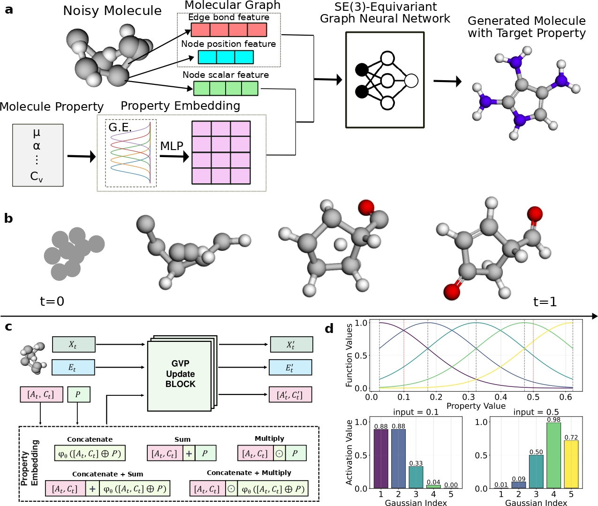

# PropMolFlow

[PropMolFlow: property-guided molecule generation with geometry-complete flow matching](https://www.nature.com/articles/s43588-025-00946-y)

## Abstract

Molecule generation is advancing rapidly in chemical discovery and drug design. Flow-matching methods have recently set the state of the art (SOTA) in unconditional molecule generation, surpassing score-based diffusion models. However, diffusion models still lead in property-guided generation. In this work, we introduce PropMolFlow, an approach for property-guided molecule generation based on geometry-complete SE(3)-equivariant flow matching. Integrating five different property embedding methods with a Gaussian expansion of scalar properties, PropMolFlow achieves competitive performance against previous SOTA diffusion models in conditional molecule generation while maintaining high structural stability and validity. Additionally, it enables higher sampling speed with fewer time steps compared with baseline models. We highlight the importance of validating the properties of generated molecules through density functional theory calculations. Furthermore, we introduce a task to assess the model's ability to propose molecules with under-represented property values, assessing its capacity for out-of-distribution generalization.



---

## Model Description

### Overview
A molecule is represented as a complete atom graph with:
- atom types (composition): $A = (a_1,\ldots,a_N)$
- formal charges: $C = (c_1,\ldots,c_N)$
- 3D coordinates: $X = (x_1,\ldots,x_N),\; x_i \in \mathbb{R}^3$
- bond types: $E$ over every atom pair

PropMolFlow is a geometry-complete SE(3)-equivariant flow matching model for **property-guided molecule generation**. It defines separate flow-matching probability paths for the discrete features (atom types, charges, bond types) and the continuous coordinates, and trains a GVP (Geometric Vector Perceptron) message passing network to predict the trajectory endpoint. The target molecular property is injected into the network through a property embedding module.

### Method

#### 1) Geometry-complete probability paths
The interpolant scheduler assigns a time-dependent weight $\alpha_t \in [0,1]$ to every feature. Coordinates follow linear interpolation between a centered-normal prior $x_0$ and the data coordinate $x_1$:

$$
x_t = (1 - \alpha_t)\, x_0 + \alpha_t\, x_1,
\qquad
v_t = \frac{\alpha_t'}{1 - \alpha_t}\,(x_1 - x_t).
$$

The categorical features (atom types, charges, bond types) follow CTMC (continuous-time Markov chain) probability paths. A masked state $\mathrm{[MASK]}$ is introduced, and each token either stays at its endpoint or becomes masked:

$$
x_t =
\begin{cases}
x_1, & \text{with probability } \alpha_t, \\
\mathrm{[MASK]}, & \text{with probability } 1 - \alpha_t.
\end{cases}
$$

The weight follows a linear ($\alpha_t = t$) or a cosine ($\alpha_t = 1 - \cos(\frac{\pi}{2} t^{\nu})^2$) schedule.

#### 2) SE(3)-equivariant GVP network
The endpoint is predicted by a GVP message passing network. Node scalar features are initialized from the atom types, the formal charges and the time, and edge features from the bond types; the property embedding is fused into the node scalars. A stack of GVP convolutions performs message passing, and every `convs_per_update` convolutions a position updater and an edge updater refresh the coordinates and the edge features. The output heads predict:
- **invariant** logits for atom types and formal charges
- **invariant** logits for bond types (from the summed features of both edge directions)
- **equivariant** updated coordinates

#### 3) Property conditioning
The scalar property is embedded by an optional Gaussian expansion followed by an MLP. Five injection strategies connect the embedding to the node scalar features: `concatenate`, `sum`, `multiply`, `concatenate_sum` and `concatenate_multiply`.

#### 4) Training objective
The training objective is a weighted sum of a coordinate loss and the categorical cross-entropy losses:

$$
\mathcal{L} =
w_X\, \lVert x_1 - \hat{x}_1 \rVert_2^2
+ w_A\, \mathcal{L}_{\mathrm{CE}}(A, \hat{A})
+ w_C\, \mathcal{L}_{\mathrm{CE}}(C, \hat{C})
+ w_E\, \mathcal{L}_{\mathrm{CE}}(E, \hat{E}),
$$

where the coordinate loss is evaluated on every atom and the cross-entropy terms on the masked tokens only.

#### 5) Sampling
Sampling integrates the learned vector field from $t = 0$ to $t = 1$. At every step the network predicts the endpoint, the coordinates are advanced along the linear velocity $v_t$ and the categorical tokens transition according to the CTMC path. An optional purity (high-confidence) threshold and a configurable stochasticity control the trajectory.

---

## Dataset Description

- **QM9 (official release)**: 130,831 small molecules with elements C, H, N, O and F, split into 110,000 / 10,000 / 10,831 for train / val / test. This adapter consumes the XYZ geometries and property columns from the existing QM9 CSV package.
- **Dataset reuse**: `PropMolFlowDataset` inherits `QM9Dataset` and calls its initializer to reuse CSV parsing, property loading, `BuildMolecule` construction and molecule caching. The adapter adds bond perception, complete-graph feature encoding and conditioning. Sampling reads the property tables without constructing unused training molecules.
- **Bonds and charges**: the five bond types over the complete atom graph and the formal atom charges are perceived with RDKit (`DetermineBonds`) while preserving the XYZ atom order. Molecule and feature caches default to `~/.paddlemat/datasets/propmolflow/`; an explicit `cache_dir` can override that location. Cache identities include the CSV content, atom map, feature version, RDKit version and any property-range selection. Feature archives are published atomically, and failed molecule perception is reported.
- **Checkpoint normalization**: the default mean/std come from the released model's rQM9 training statistics, stored with source SHA256 in `ppmat/models/propmolflow/qm9_normalization.json`. The original preprocessing uses the full 100,000-molecule training split and sample standard deviation (`ddof=1`). Training, validation and sampling share these fixed statistics without changing package YAML or checkpoint tensors.
- **Custom normalization**: an explicit `normalization_source` CSV replaces the checkpoint statistics with that file's population mean/std (`ddof=0`). Use the same training-only source for every split and sampler. Its values are read independently of `property_range`; supply a CSV containing exactly the intended training population. Missing files, nonfinite values and zero variance raise errors. The default checkpoint statistics do not constitute statistics fitted to a new custom split.

Recommended data fields for each sample:
- `atom_types`: length-$N$ atom types (C, H, N, O, F)
- `atom_charges`: length-$N$ formal charges
- `positions`: $N \times 3$ centered Cartesian coordinates
- `bond_types`: bond-type labels over the complete graph
- `property`: the conditioned scalar property (for example `alpha`, `mu`, `gap`)

The CSV may omit `num_atoms`; it is derived from each XYZ header. Returned
samples always include `structure_array.num_atoms`.

#### QM9 split (download link)
| Dataset | Train | Val | Test |
| --- | --- | --- | --- |
| [QM9](https://paddle-org.bj.bcebos.com/paddlematerials/datasets/qm9/qm9.zip) | 110000 | 10000 | 10831 |

---

## Results

The following compatibility smoke was re-evaluated on 2026-11-14 using the
current adapter: CPU FP32, 16 samples per checkpoint, batch size 8, seed 42
and 100 integration points. Every row uses in-distribution sampling, including
checkpoints whose names contain `_ood`. All 160 SDF records can be read;
158 pass RDKit sanitization. These small samples do not estimate population
quality or establish target-property accuracy.

All ten current online archives were downloaded and loaded separately. Their
checkpoint bytes and Model/Sampler settings match the cached packages used
in this run. This refactor edits neither archive contents nor package YAML.
The weights were trained with rQM9 preprocessing; official-QM9 geometries,
perceived labels and split populations remain a different data protocol.

| Model | Property | Handling | RDKit Valid | Valid & Unique | Config | Weights |
| --- | --- | --- | --- | --- | --- | --- |
| propmolflow_qm9_Cv_sum | Cv | sum | 1.0000 | 1.0000 | [config](propmolflow_qm9_Cv_sum.yaml) | [checkpoint](https://paddle-org.bj.bcebos.com/paddlematerials/checkpoints/structure_generation/propmolflow/propmolflow_qm9_Cv_sum.zip) |
| propmolflow_qm9_alpha_sum | alpha | sum | 1.0000 | 1.0000 | [config](propmolflow_qm9_alpha_sum.yaml) | [checkpoint](https://paddle-org.bj.bcebos.com/paddlematerials/checkpoints/structure_generation/propmolflow/propmolflow_qm9_alpha_sum.zip) |
| propmolflow_qm9_gap_concatenate_ood | gap | concatenate | 1.0000 | 1.0000 | [config](propmolflow_qm9_gap_concatenate_ood.yaml) | [checkpoint](https://paddle-org.bj.bcebos.com/paddlematerials/checkpoints/structure_generation/propmolflow/propmolflow_qm9_gap_concatenate_ood.zip) |
| propmolflow_qm9_gap_concatenate_sum | gap | concatenate_sum | 1.0000 | 1.0000 | [config](propmolflow_qm9_gap_concatenate_sum.yaml) | [checkpoint](https://paddle-org.bj.bcebos.com/paddlematerials/checkpoints/structure_generation/propmolflow/propmolflow_qm9_gap_concatenate_sum.zip) |
| propmolflow_qm9_homo_concatenate | homo | concatenate | 1.0000 | 1.0000 | [config](propmolflow_qm9_homo_concatenate.yaml) | [checkpoint](https://paddle-org.bj.bcebos.com/paddlematerials/checkpoints/structure_generation/propmolflow/propmolflow_qm9_homo_concatenate.zip) |
| propmolflow_qm9_homo_concatenate_sum_ood | homo | concatenate_sum | 0.9375 | 0.9375 | [config](propmolflow_qm9_homo_concatenate_sum_ood.yaml) | [checkpoint](https://paddle-org.bj.bcebos.com/paddlematerials/checkpoints/structure_generation/propmolflow/propmolflow_qm9_homo_concatenate_sum_ood.zip) |
| propmolflow_qm9_lumo_concatenate_multiply_ood | lumo | concatenate_multiply | 1.0000 | 1.0000 | [config](propmolflow_qm9_lumo_concatenate_multiply_ood.yaml) | [checkpoint](https://paddle-org.bj.bcebos.com/paddlematerials/checkpoints/structure_generation/propmolflow/propmolflow_qm9_lumo_concatenate_multiply_ood.zip) |
| propmolflow_qm9_lumo_concatenate_sum | lumo | concatenate_sum | 1.0000 | 1.0000 | [config](propmolflow_qm9_lumo_concatenate_sum.yaml) | [checkpoint](https://paddle-org.bj.bcebos.com/paddlematerials/checkpoints/structure_generation/propmolflow/propmolflow_qm9_lumo_concatenate_sum.zip) |
| propmolflow_qm9_mu_multiply | mu | multiply | 0.9375 | 0.9375 | [config](propmolflow_qm9_mu_multiply.yaml) | [checkpoint](https://paddle-org.bj.bcebos.com/paddlematerials/checkpoints/structure_generation/propmolflow/propmolflow_qm9_mu_multiply.zip) |
| propmolflow_qm9_mu_sum_ood | mu | sum | 1.0000 | 1.0000 | [config](propmolflow_qm9_mu_sum_ood.yaml) | [checkpoint](https://paddle-org.bj.bcebos.com/paddlematerials/checkpoints/structure_generation/propmolflow/propmolflow_qm9_mu_sum_ood.zip) |

---

## Command

### Training

Eager execution remains the default. GPU CINN forward, registered alpha
sampling and a paired one-epoch training smoke have been checked on Paddle
3.3.0 / RTX 5090 D. Each training backend performed two updates over eight real
molecules, with four validation molecules. All 620 checkpoint tensors pass
`atol=5e-5, rtol=2e-5`; the maximum absolute difference is
`3.328174352645874e-5`. The absolute tolerance was increased from `2e-5` for
this review; the original comparison exceeded it in two elements. Losses,
gradients and parameters remained finite. This small run does not establish
long-run convergence or qualify other devices and training configurations.

Before multi-GPU training, construct the caches once in a single process:

```python
from omegaconf import OmegaConf
from ppmat.datasets import build_dataloader

config = OmegaConf.load(
    "structure_generation/configs/propmolflow/propmolflow_qm9_alpha_sum.yaml"
)
config = OmegaConf.to_container(config, resolve=True)
for stage in ("train", "val"):
    build_dataloader(config["Dataset"][stage])
```

The adapter checks cache readiness collectively before entering the QM9 parent.
Missing or incompatible caches fail on every rank with a prewarm instruction.
Use the same `num_cpus` setting for prewarming and distributed training;
`rebuild=True` requires single-process construction.

```bash
# multi-gpu training (example with 4 GPUs)
python -m paddle.distributed.launch --gpus="0,1,2,3" structure_generation/train.py -c structure_generation/configs/propmolflow/propmolflow_qm9_alpha_sum.yaml
# single-gpu training
python structure_generation/train.py -c structure_generation/configs/propmolflow/propmolflow_qm9_alpha_sum.yaml
```

### Validation
```bash
# Adjust program behavior on the fly using command-line parameters without modifying the configuration file directly.
# Example: --Global.do_eval=True
python structure_generation/train.py -c structure_generation/configs/propmolflow/propmolflow_qm9_alpha_sum.yaml Global.do_eval=True Global.do_train=False Global.do_test=False Trainer.pretrained_model_path='path/to/model.pdparams'
```

### Testing
```bash
# Evaluate the model on the test dataset.
python structure_generation/train.py -c structure_generation/configs/propmolflow/propmolflow_qm9_alpha_sum.yaml Global.do_eval=False Global.do_train=False Global.do_test=True Trainer.pretrained_model_path='path/to/model.pdparams'
```

### Sample

You can replace `model_name` with other model names from the Results table.
The generated molecules are saved to `Sampler.output_dir`.
Existing downloaded packages remain compatible with the sampling recipe below.

This adapter refactor keeps the existing package schema and weights. Older
packages can still name `PropMolFlowCollator` in their training loaders; the
sampling recipe disables that unused loader with `Dataset.train=null`.
For training or resume, use the repository configuration and the downloaded
checkpoint rather than the package's legacy loader configuration.

```python
from ppmat.sampler import MolecularSampler

# Mode 1: Use a pre-trained model (downloads automatically).
# Mode 2: Use a custom configuration file and checkpoint.
sampler = MolecularSampler(
    model_name="propmolflow_qm9_alpha_sum",
    # config_path="structure_generation/configs/propmolflow/propmolflow_qm9_alpha_sum.yaml",
    # checkpoint_path="./output/propmolflow_qm9_alpha_sum/checkpoints/latest.pdparams",
    config_overrides=[
        "Dataset.train=null",
        "Sampler.data.dataset.__init_params__.total_num=64",
        "Sampler.model_sample_params.num_inference_steps=100",
        "Sampler.output_dir=./output/propmolflow_samples",
    ],
)
results = sampler.sample_by_dataloader()
sampler.model.save_samples(results["pred"], sampler.output_dir)
```

To sample out-of-distribution molecules at a single target value, add
`Sampler.data.dataset.__init_params__.mode=out_of_distribution` and
`Sampler.data.dataset.__init_params__.property_value=93.3` to
`config_overrides`. To use a fixed number of atoms, add
`Sampler.data.dataset.__init_params__.n_atoms=18`.

`num_inference_steps` must be at least 2. Without `normalization_source`, the
sampler uses the bundled checkpoint statistics, including when the input CSV
has a custom name or no sibling `train.csv`.

### OOD experiment scope

The `_ood` model names identify released checkpoints; their default sampling
mode remains `in_distribution`. Setting an explicit target value exercises
conditional generation and does not establish that the target lies outside
the checkpoint's training distribution.

The repository's official-QM9 configs do not reproduce the original rQM9 OOD
training split. A new OOD experiment must specify disjoint training/evaluation
populations, the held-out property interval and its normalization source.
`PropMolFlowDataset.property_range=[lower, upper]` optionally selects the
half-open interval `[lower, upper)` before molecular preprocessing, with its
selection included in the cache identity. Set an explicit training-only
`normalization_source` for a custom experiment. Do not interpret the released
checkpoint sampling table as validation of newly trained OOD checkpoints.

---

## Citation
```
@article{zeng2026propmolflow,
  title={PropMolFlow: property-guided molecule generation with geometry-complete flow matching},
  author={Zeng, Cheng and Jin, Jirui and Ambrose, Connor and Karypis, George and Transtrum, Mark and Tadmor, Ellad B. and Hennig, Richard G. and Roitberg, Adrian and Martiniani, Stefano and Liu, Mingjie},
  journal={Nature Computational Science},
  volume={6},
  pages={233--242},
  year={2026},
  publisher={Nature Publishing Group},
  doi={10.1038/s43588-025-00946-y}
}
```
