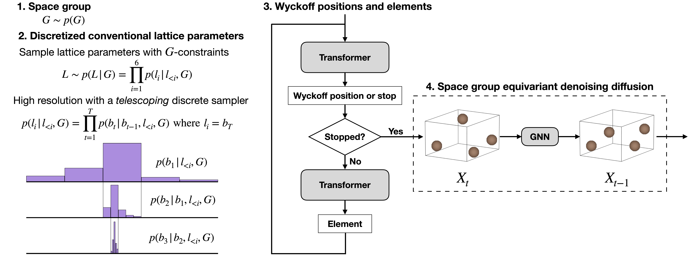

# SGEquiDiff

[Space Group Equivariant Crystal Diffusion](https://arxiv.org/abs/2505.10994)

## Abstract

SGEquiDiff generates crystals with explicit space-group constraints. It combines
lattice sampling, autoregressive generation of elements and Wyckoff sites, and
equivariant diffusion of coordinates within the asymmetric unit (ASU).



---

## Model Description

### Overview

A single `SGEQuiDiff` model learns the joint distribution of space groups,
lattice parameters, elements, Wyckoff sites, and ASU fractional coordinates.
Sampling expands the ASU through symmetry operations into a full conventional
cell, returned as `num_atoms`, `atom_types`, `frac_coords`, and `lattice` for the
standard array-to-CIF conversion.

### Method

1. A categorical distribution samples the space group.
2. A telescoping discrete sampler generates lattice lengths and angles subject
   to Bravais lattice constraints.
3. An autoregressive transformer generates elements and Wyckoff sites until a
   stop token is sampled.
4. Coordinate diffusion uses a projected VE-SDE on the ASU. The GNN vector field
   is symmetrized over the space-group operations, and predictor-corrector
   updates preserve the Wyckoff constraints.

The training objective combines the discrete negative log likelihoods with
coordinate score matching. `ASUVESDEScheduler` is built through the scheduler
factory; lattice and element generation are discrete autoregressive processes,
so they do not use diffusion schedulers. The ASU geometry requires projected
noise and symmetry-aware wrapping rather than an unconstrained torus scheduler.

Generation is unconditional. Input atom counts determine only the batch size;
atom-count, chemical-formula, and property conditioning are unsupported.
`num_inference_steps` selects points from the trained noise grid, including
both endpoints. The default uses all 1000 points (999 predictor-corrector
updates); fewer points are useful for debugging and change generation quality.

`ValidityDiversityCoverageMetric` measures validity, uniqueness, novelty, and
fingerprint coverage of crystal arrays or CIFs independently of the model.
Use `input_format: array`, `cif_str`, or `cif_file`; select validity, uniqueness,
novelty, and coverage through `metrics`.
Structure/SMACT checks, matcher tolerances, coverage cutoffs, and distance batch
size are configured explicitly under `Sample.metrics.__init_params__`.

SGEquiDiff's configured [Magpie statistics](../../../ppmat/models/sgequidiff/magpie_legacy_statistics.json)
preserve its previous evaluation scale, with ordered feature names and source
metadata. Their original fitting population is not verified. Supply `coverage_cfg.statistics_path` instead of `statistics_resource`
to use a separately calibrated statistics file; evaluation never fits a scaler
to generated samples. Validity and uniqueness alone need neither statistics
nor reference data.

Novelty and uniqueness use valid generations as their denominator; coverage
uses available fingerprints. Fingerprint failures do not change validity.
Set `novelty_gt_file_path` to use a training reference pool separately from the
coverage reference in `gt_file_path`. The configurations retain their previous
test-reference protocol and structural/composition cutoffs of 0.4/10.0.

The input transform derives ASU supervision using the reference symmetry
tolerances (0.1 angstrom, 5 degrees), origin choice 2 where available, and the
model's Wyckoff vocabulary. The original CIF property is used for symmetry
analysis because float32 structure arrays can change Wyckoff assignments.
The base `structure_array` and properties are preserved; variable-length ASU
fields use `ConcatData` with `DefaultCollator`. Niggli reduction and
canonicalization are disabled in the dataset configs.

---

## Dataset Description

MP-20 uses `MP20Dataset`; MPTS-52 uses its thin `MPTS52Dataset` subclass.
Both read CSV files containing CIF strings and apply `AsymmetricUnitTransform`.

| Dataset | Train | Val | Test |
| --- | --- | --- | --- |
| [MP-20](https://paddle-org.bj.bcebos.com/paddlematerial/datasets/mp_20/mp_20.zip) | 27136 | 9047 | 9046 |
| [MPTS-52](https://paddle-org.bj.bcebos.com/paddlematerials/datasets/mpts_52/mpts_52.zip) | 27380 | 5000 | 8096 |

Missing CSV splits use the dataset's configured download source. MPTS-52 needs
the companion CSV archive (`mpts_52/{train,val,test}.csv`); the former ASU-only
NPZ archive cannot be used as its replacement. Quality evaluation reads the
reference CIFs from `Sample.metrics.__init_params__.gt_file_path`.

The [official implementation](https://github.com/rees-c/sgequidiff) provides
[original MP-20 data](https://drive.google.com/file/d/1avOCeo-OMtkKYPkDO0pz0IY36gBq8-kE/view),
[original MPTS-52 data](https://drive.google.com/file/d/1rPMi0HKMtBccAczkgg-S-kCqSS63Jy1T/view),
and [original checkpoints](https://drive.google.com/drive/folders/1ONwO53i6oG1_yBqP0zPQ-IV_zLoIWyQR).

---

## Results

| Model | Dataset | Valid (%) | Unique (%) | Novel (%) | Coverage recall (%) | Coverage precision (%) | Config | Checkpoint |
| --- | --- | --- | --- | --- | --- | --- | --- | --- |
| sgequidiff_mp20 | mp20 | 71.88 | 100.00 | 100.00 | 44.53 | 75.00 | [sgequidiff_mp20.yaml](sgequidiff_mp20.yaml) | [checkpoint](https://paddle-org.bj.bcebos.com/paddlematerials/checkpoints/structure_generation/SGEquiDiff/sgequidiff_mp20.zip) |
| sgequidiff_mpts_52 | mpts52 | 78.12 | 100.00 | 100.00 | 31.25 | 59.38 | [sgequidiff_mpts_52.yaml](sgequidiff_mpts_52.yaml) | [checkpoint](https://paddle-org.bj.bcebos.com/paddlematerials/checkpoints/structure_generation/SGEquiDiff/sgequidiff_mpts_52.zip) |

These are small-scale proxy evaluations of converted official checkpoints, with
32 generations per model, seed 42, and the complete 1000-point noise grid.
Novelty and coverage use the first 128 CIFs of the corresponding test split.
They do not establish full-benchmark performance or results from training the
current YAML from scratch. Energy stability and S.U.N. were not evaluated.

---

## Command

### Training

```bash
python structure_generation/train.py -c structure_generation/configs/sgequidiff/sgequidiff_mp20.yaml Trainer.pretrained_model_path=null
```

Omit the override to fine-tune the converted official checkpoint.

### Validation

```bash
python structure_generation/train.py -c structure_generation/configs/sgequidiff/sgequidiff_mp20.yaml Global.do_train=False Global.do_eval=True
```

### Testing

```bash
python structure_generation/train.py -c structure_generation/configs/sgequidiff/sgequidiff_mp20.yaml Global.do_train=False Global.do_test=True
```

Validation and testing report the generative training objective on their
respective splits, using the pretrained checkpoint configured in the YAML.

### Sample

```bash
python structure_generation/sample.py --model_name=sgequidiff_mp20 --mode=by_dataloader
```

The default configuration generates 100 unconditional crystals without loading
an ASU dataset. Replace `sgequidiff_mp20` with `sgequidiff_mpts_52` (and the YAML
path for training or evaluation) to use MPTS-52.

---

## Citation
```
@misc{chang2025spacegroupequivariantcrystal,
      title={Space Group Equivariant Crystal Diffusion},
      author={Rees Chang and Angela Pak and Alex Guerra and Ni Zhan and Nick Richardson and Elif Ertekin and Ryan P. Adams},
      year={2025},
      eprint={2505.10994},
      archivePrefix={arXiv},
      url={https://arxiv.org/abs/2505.10994},
}
```
