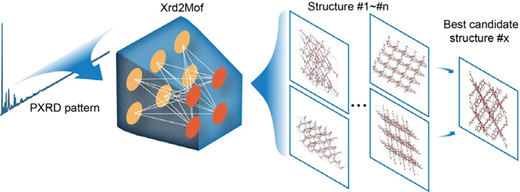

# Xrd2Mof

[Interpreting X-Ray Diffraction Patterns of Metal-Organic Frameworks via Generative Artificial Intelligence](https://doi.org/10.1021/jacs.5c16416)

## Abstract

Xrd2Mof predicts coarse-grained (CG) MOF structures from powder X-ray diffraction
(PXRD), metal-node descriptors and organic-linker graphs. A pretrained feature
extractor conditions joint diffusion of the lattice and CG site coordinates.
This integration generates CG structures without atomistic assembly.



---

## Model Description

### Overview

A CG unit cell consists of:

- site types $A$: metal nodes (`0`) and organic linkers (`1`);
- fractional coordinates $X \in [0,1)^{N \times 3}$;
- lattice matrix $L \in \mathbb{R}^{3 \times 3}$.

The feature extractor combines PXRD, metal and linker inputs into a 256-dimensional
condition $C$. Generation uses fixed site types and counts. Exported CIFs use
`Xmetal` and `Xlinker` dummy species for CG centers, not physical atomic species.

### Method

#### 1) Lattice diffusion

The lattice uses a Gaussian DDPM process:

$$
L_t = \sqrt{\bar{\alpha}_t} L_0 + \sqrt{1-\bar{\alpha}_t}\,\epsilon_L,
\qquad \epsilon_L \sim \mathcal{N}(0,I).
$$

#### 2) Fractional-coordinate diffusion

Wrapped Gaussian noise preserves periodicity:

$$
X_t = (X_0 + \sigma_t\epsilon_X) \bmod 1,
\qquad \epsilon_X \sim \mathcal{N}(0,I).
$$

#### 3) Conditioned denoising and sampling

CSPNet combines site, condition and time embeddings on a fully connected graph.
Messages use periodic Fourier features, $LL^\top$ and mean neighbor aggregation.
The training objective is

$$
\mathcal{L} = 0.1\,\operatorname{MSE}(\hat\epsilon_L,\epsilon_L)
+ \operatorname{MSE}(\hat s_X,s_t),
$$

where $s_t$ is the wrapped-normal negative score normalized by the square root
of its estimated second moment. Sampling uses a coordinate predictor-corrector
and ancestral lattice updates, with 1000 steps by default.

Optional classifier-free guidance requires conditional-dropout training.
The released weights use `p_unconditional: 0.0` and `guidance_scale: 1.0`.

---

## Dataset Description

| Dataset | Train | Val | Test |
| --- | --- | --- | --- |
| [cgmof50 demo](https://paddle-org.bj.bcebos.com/paddlematerials/datasets/MOF_PXRD/xrd2mof_cgmof50_data.zip) | 12 | 4 | 16 |

The demo contains four experimental PXRD cases (BIFWIY, DAKZAS, DUDZOR and
VAWXAS01) with 16 candidate CG count configurations. Train/val coordinates and
cells are synthetic and support workflow checks only; the test split has no
reference CG coordinates. Reproducing the paper's benchmark requires the full
CSD-derived dataset.

Training and sampling use precomputed 256-dimensional feature embeddings and CG
structure arrays. The CLI does not accept raw PXRD patterns directly.

---

## Results

| Model | Dataset | Match Rate (%) | RMS Dist | GPUs | Training Time | Config | Checkpoint / Log |
| --- | --- | --- | --- | --- | --- | --- | --- |
| xrd2mof_cgmof50 (trained, default) | cgmof50 demo val | 2.50 | 0.1568 | 1 | 20 min 48 s | [xrd2mof_cgmof50.yaml](xrd2mof_cgmof50.yaml) | [Train locally](#training) |

The training result uses the best local checkpoint selected by validation loss.
Training time includes validation and checkpoint saving.

| Checkpoint | Corrector snr | Match Rate (%) | RMS Dist |
| --- | --- | --- | --- |
| [Pretrained source](https://paddle-org.bj.bcebos.com/paddlematerials/checkpoints/spectrum_elucidation/xrd2mof/xrd2mof_cgmof50.zip) | 1e-5 | 10.00 | 0.3412 |
| Same checkpoint | 1e-3 | 10.00 | 0.2149 |

Sampling metrics use 40 predictions per setting on the demo validation split.
RMS Dist is normalized and averaged over matched predictions. Results are limited
to this demo split. Registered sampling uses the converted official checkpoint.

---

## Command

### Training

```bash
python structure_generation/train.py -c structure_generation/configs/xrd2mof/xrd2mof_cgmof50.yaml
```

Training writes `checkpoints/best.pdparams` under
`output/xrd2mof_cgmof50_t_<timestamp>_s_42/`. Set `CHECKPOINT` to that file's
path for validation or local-checkpoint sampling. These local training weights
are separate from the registered pretrained weights.

### Validation

Validation reports the denoising loss.

```bash
python structure_generation/train.py -c structure_generation/configs/xrd2mof/xrd2mof_cgmof50.yaml Global.do_eval=True Global.do_train=False Trainer.pretrained_model_path="${CHECKPOINT:?}"
```

### Testing

The test split contains conditioning inputs only. Use the sampling command.

### Sample

```bash
python structure_generation/sample.py --model_name=xrd2mof_cgmof50 --mode=by_dataloader
```

To sample a local checkpoint:

```bash
python structure_generation/sample.py --config_path=structure_generation/configs/xrd2mof/xrd2mof_cgmof50.yaml --checkpoint_path="${CHECKPOINT:?}" --mode=by_dataloader
```

CG CIFs are saved to `results/`. Chemical-formula-only and atom-count-only
sampling are unsupported because XRD conditioning is required.

---

## Citation

```bibtex
@article{feng2026xrd2mof,
  title   = {Interpreting {X}-ray Diffraction Patterns of {M}etal-{O}rganic Frameworks via Generative Artificial Intelligence},
  author  = {Feng, Bin and Wang, Bingxu and Lv, Linpeng and Zhang, Mingzheng and Chen, Zhefeng and Pan, Feng and Li, Shunning},
  journal = {Journal of the American Chemical Society},
  volume  = {148},
  number  = {1},
  pages   = {869--878},
  year    = {2026},
  doi     = {10.1021/jacs.5c16416}
}
```

Original implementation: [PKUsam2023/Xrd2Mof](https://github.com/PKUsam2023/Xrd2Mof).
